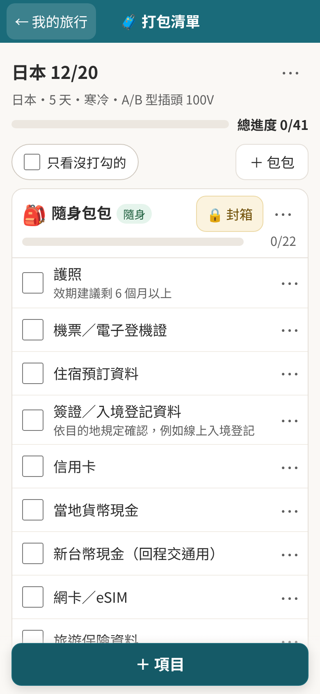
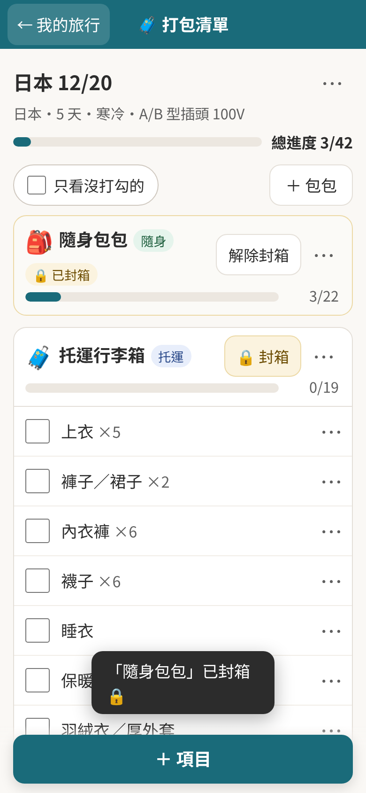
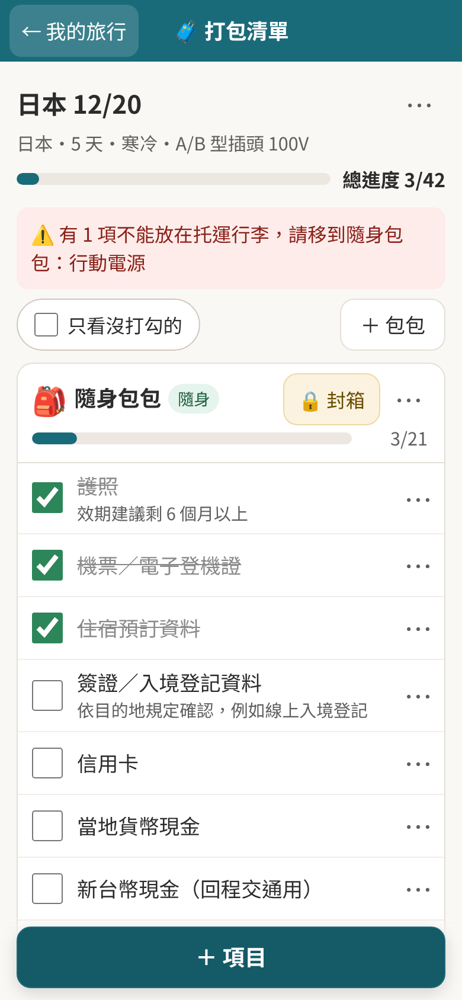

# 🧳 EZpakku（repo：packing-list）

> 網站名稱：**EZpakku**（2026-10 由「打包清單」改名）。repo 名稱、網址 `/packing-list/` 和 localStorage key `packing-list:v1` 先不改，避免使用者的清單不見、舊連結失效。

依目的地自動產生行李清單的網站，以手機為主。主打功能是 **「包包＋封箱＋每個包包的進度」**。

- 預覽網址（GitHub Pages）：https://56webb.github.io/packing-list/
- 第一版：只有繁體中文（網址已經用 `/zh-tw/`，之後加語言很容易）
- 不用註冊：資料存在你自己的瀏覽器（localStorage）
- 可以「加到主畫面」，沒網路也能打開（PWA）

<p>
  
  
  
</p>

> 這一版是 L 先幫 RY 做出來的。下面每一步都寫了「做了什麼、為什麼」，方便 RY 之後自己在 Cursor 裡接手。

---

## 1. 現在有哪些功能

| 功能 | 說明 |
|---|---|
| 多趟旅行 | 首頁列出所有旅行，每趟各自有包包和物品 |
| 行程表單 | 目的地（30 個熱門國家＋其他）、出發日期、天數、旅行類型（城市／海島／滑雪／出差／帶小孩，可複選）、行李方案（廉航 7kg 登機箱／有托運）、氣候（自動或手動） |
| 自動產生清單 | 依「氣候＋天數＋旅行類型＋行李方案＋插頭電壓」組合。衣服數量依天數計算（最多算 7 天，超過建議洗衣） |
| 轉接頭／電壓 | 目的地沒有台灣的 A／B 型插座才加「萬用轉接頭」；電壓 ≥200V 時提醒確認電器支援 100–240V |
| 包包 | 預設「隨身包包」＋「登機箱」或「托運行李箱」。可新增、改名、換圖示、標記有放追蹤器、刪除（物品會移到「未指定」，不會消失） |
| 封箱 | 每個包包可以封箱，封箱後自動收起、不能再打勾；還有沒打勾的會先問你 |
| 進度 | 頂部總進度＋每個包包自己的進度條 |
| 物品 | 打勾、新增、編輯（名稱、數量、包包、分類、備註）、刪除（可以「復原」） |
| 規定標籤 | 行動電源、備用鋰電池、打火機（不能托運）、液體 100ml、含鋰電池電子產品、電壓。點標籤會顯示說明和**官方來源連結** |
| 托運警告 | 不能托運的東西被放進「托運」包包時，畫面頂部出現紅色警告 |
| 分享、列印 | 「⋯」選單裡可以把清單變成文字分享到 LINE，或列印 |
| 備份 | 匯出／匯入 JSON 檔（換手機時用） |
| 離線 | 第一次打開後，沒網路也能用 |
| 導購位置 | 每個物品都預留了「還沒有？去買」按鈕，目前**關閉**（見 `src/scripts/config.js`） |

**還沒做的**：Supabase 登入與跨裝置同步、Cloudflare Pages 正式部署、網域、導購連結、英文／日文、航班行李規定、多人共用清單。

---

## 2. 在自己電腦上跑起來

需要先安裝 **Node.js 22.22 以上**（建議到 https://nodejs.org 下載 LTS 版）和 **Git**。

```bash
# 1. 下載程式碼
git clone https://github.com/56webb/packing-list.git
cd packing-list

# 2. 安裝套件（第一次、或 package.json 有改時才需要）
npm install

# 3. 開發模式：改程式後瀏覽器會自動更新
npm run dev
# 打開終端機顯示的網址，例如 http://localhost:4321/packing-list/

# 4. 建置正式版（產生 dist/ 資料夾）並在本機預覽
npm run build
npm run preview
```

> 開發模式不會啟用離線功能（Service Worker），這是故意的，避免快取讓你看不到最新的修改。

---

## 3. 專案結構（每個檔案在做什麼）

```
packing-list/
├─ astro.config.mjs          Astro 設定。base: '/packing-list' 是因為 GitHub Pages 網址有這一段
├─ package.json              套件清單與指令（dev / build / preview）
├─ public/                   原封不動複製到網站的檔案
│  ├─ manifest.webmanifest   「加到主畫面」需要的設定（名稱、圖示、顏色）
│  ├─ sw.js                  Service Worker：離線可用
│  └─ icons/                 App 圖示
├─ src/
│  ├─ pages/
│  │  ├─ index.astro         網站首頁 / ：依瀏覽器語言跳到 /zh-tw/
│  │  └─ zh-tw/index.astro   繁中版的主頁面（整個 App 在這頁）
│  ├─ layouts/Base.astro     共用外框：<head>、標題列、對話框、提示訊息
│  ├─ styles/global.css      全站樣式（手機優先）
│  ├─ i18n/
│  │  ├─ zh-tw.json          所有畫面文字（字典檔）。之後加 en.json 就有英文版
│  │  └─ index.js            t('key') 取得翻譯的小工具
│  ├─ data/
│  │  ├─ countries.json      30 個國家：插頭、電壓、代表城市每月平均氣溫（附來源）
│  │  ├─ items.json          預設物品與出現條件（規則）
│  │  └─ rules.json          規定標籤與官方來源連結
│  └─ scripts/
│     ├─ app.js              畫面：首頁、表單、清單、對話框
│     ├─ store.js            資料中心：所有新增／修改／刪除都在這裡
│     ├─ storage.js          儲存轉接器：現在是 localStorage，之後加 Supabase
│     ├─ generator.js        清單產生器（規則引擎）
│     ├─ dom.js              安全的畫面小工具（h()、對話框、toast）
│     └─ config.js           功能開關（導購按鈕）
└─ .github/workflows/deploy.yml   push 到 main 就自動部署到 GitHub Pages
```

### 資料結構

```
旅行 trips  ─┬─ 包包 bags   （tripId 指向旅行）
             └─ 物品 items  （tripId 指向旅行、bagId 指向包包；bagId = null 就是「未指定」）
```

- 每一筆都有 `id`，用瀏覽器內建的 `crypto.randomUUID()` 產生（不會撞號）。
- 物品用 **包包的 id** 綁定，不是用包包名稱 → 包包改名也不會壞。
- 三種資料是「扁平」存的，跟之後 Supabase 的三張資料表一模一樣，搬上雲端很直接。
- 每次修改，store 都會產生一份「改了哪幾列」的清單（`changes`），之後的 Supabase 版本可以只更新那幾列，不會整份覆蓋（舊版「台南打包大王」的問題）。

### 安全

- 使用者輸入的文字一律用 `textContent` 顯示，**整個專案沒有用 innerHTML 放使用者資料**，所以不會有 XSS（被塞惡意程式）。已用 ``、`<script>` 實測，不會執行。
- 匯入的備份檔會先檢查格式：id 只能是英數和 `-`、包包圖示只能從固定清單選、標籤只能是已知的，不合格的資料直接丟掉。
- 這個 repo **沒有任何金鑰或密碼**。之後加 Supabase 時，網址和公開金鑰（anon key）放在環境變數，不要寫進程式；`.env` 已經在 `.gitignore` 裡。

### 資料來源（不能用猜的）

- **插頭與電壓**：Wikipedia〈Mains electricity by country〉（整理自 IEC World Plugs），2026-10-17 擷取。https://en.wikipedia.org/wiki/Mains_electricity_by_country
- **氣溫**：各國代表城市的 Wikipedia 氣候表「每日平均氣溫」（多數來自各國氣象局），連結寫在 `countries.json` 每一筆的 `climateSource`。只是代表城市的概略值，同一國各地差很多，所以表單可以手動選氣候。
- **行動電源**：交通部民航局，2026-04-08 起每人限 2 個、不可托運、機上不可充電。https://www.caa.gov.tw/NewsPublish-Content.aspx?a=381&lang=1&nid=2547
- **鋰電池、電子產品**：民航局〈旅客及組員可攜帶或託運上機之危險物品表〉。https://www.caa.gov.tw/FileAtt.ashx?id=40793&lang=1
- **液體 100ml、打火機**：民航局公告（行政院公報）與桃園機場〈行李攜帶規定〉。https://www.taoyuan-airport.com/customsdeclarations

規定會改，**上線前和之後每年都要重新確認一次**。

---

## 4. 這一版是怎麼做出來的（指令紀錄）

```bash
# 1. 用 Astro 官方工具建立空白專案（minimal 範本）
npm create astro@latest -- packing-list --template minimal --no-install --no-git

# 2. 安裝套件
cd packing-list
npm install

# 3. 寫程式（見上面的專案結構），然後建置
npm run build

# 4. 用無頭 Chrome 自動測試（手機 390×844、桌機 1440×900）：
#    建立旅行 → 產生清單 → 打勾 → 封箱 → 重新整理資料還在 → XSS 測試 → 離線測試

# 5. 建立 GitHub repo 並上傳
git init -b main
git add .
git commit -m "第一版：打包清單網站"
gh repo create 56webb/packing-list --public --source . --push

# 6. 開啟 GitHub Pages（來源選 GitHub Actions），之後每次 push 都會自動部署
gh api -X POST repos/56webb/packing-list/pages -f build_type=workflow
```

**為什麼是公開（public）repo？** GitHub 免費帳號的私人 repo 不能開 GitHub Pages。這個 repo 裡沒有任何密碼、金鑰或個人行程，所以公開沒有風險。之後搬到 Cloudflare Pages 後，想改回私人也可以（Cloudflare 可以部署私人 repo）。

---

## 5. 怎麼部署

### 現在：GitHub Pages（自動）
push 到 `main` 分支 → GitHub Actions 會跑 `.github/workflows/deploy.yml` → 約 1–2 分鐘後網站更新。到 repo 的 **Actions** 分頁可以看進度。

### 之後：Cloudflare Pages（正式上線用，允許商業用途）
1. 註冊 Cloudflare 帳號 → Workers & Pages → Create → Pages → 連接 GitHub，選 `packing-list`。
2. Framework preset 選 **Astro**；Build command：`npm run build`；Output directory：`dist`。
3. 環境變數加 `BASE_PATH` = `/`（因為自己的網域不需要 `/packing-list` 這一段），`SITE_URL` = 你的網址。
4. 部署成功後，再決定網域（**要花錢，先確認**）。

---

## 6. 下一步：可以直接貼給 Cursor 的指令

使用方式：在 Cursor 打開這個專案，按 `Cmd + L` 開聊天，把整段貼上。做完一段先 `npm run dev` 測試，再 commit。

### ① 加 Supabase 登入（可選）＋跨裝置同步

> 先在 https://supabase.com 建立專案（RY 本人操作），拿到 Project URL 和 anon key。

```
請幫我在這個 Astro 專案加入「可選擇的」Supabase 登入與同步，不登入也要能照常使用。
規則：
1. 安裝 @supabase/supabase-js。網址和金鑰從環境變數 PUBLIC_SUPABASE_URL、PUBLIC_SUPABASE_ANON_KEY 讀取，建立 .env.example，不要把真的金鑰寫進程式或 commit。
2. 給我一份 supabase/schema.sql：建立 trips、bags、items 三張表，欄位對應 src/scripts/store.js 註解裡的資料結構，每張表加 user_id (uuid, 預設 auth.uid())，並且「一定要開 RLS」，policy 只允許 user_id = auth.uid() 的人讀寫自己的資料。
3. 在 src/scripts/storage.js 新增 createSupabaseAdapter(supabase, userId)，介面跟 createLocalStorageAdapter 一樣（load / save(state, changes)），save 時依 changes 一筆一筆 upsert / delete，不要整份覆蓋。用 updated_at 判斷新舊。
4. 標題列加「用 Google 登入」按鈕（登入後顯示頭像與登出）。第一次登入時，把 localStorage 裡已有的旅行合併上傳到雲端。
5. 沒網路時繼續存 localStorage，恢復網路再同步。
6. 所有使用者資料仍然只能用 textContent 顯示，不可以用 innerHTML。
7. 在 README 補上步驟說明（繁體中文）。
```

### ② 搬到 Cloudflare Pages

```
我要把這個 Astro 網站從 GitHub Pages 搬到 Cloudflare Pages。
1. astro.config.mjs 的 base 已經可以用環境變數 BASE_PATH 覆蓋，請確認 BASE_PATH=/ 時所有連結、manifest、service worker 都正常（npm run build 後檢查 dist）。
2. 新增 public/_headers：sw.js 不要快取（Cache-Control: no-cache），其他 /_astro/* 檔案長期快取。
3. 告訴我在 Cloudflare 後台要填哪些設定（Build command、Output directory、環境變數），用繁體中文一步一步寫。
4. GitHub Pages 的 workflow 先保留，等 Cloudflare 確認沒問題再刪。
```

### ③ 打開導購按鈕（拿到聯盟帳號之後）

```
我已經申請到聯盟行銷帳號，要打開物品旁邊的「還沒有？去買」按鈕。
1. 在 src/scripts/config.js 的 BUY_LINKS 填入我提供的連結（esim、adapter …），然後把 SHOW_BUY_BUTTONS 改成 true。
2. 連結要加 rel="sponsored noopener"、target="_blank"。
3. 新增一頁 src/pages/zh-tw/disclosure.astro「聯盟行銷揭露」，用白話說明：透過連結購買我們可能獲得佣金，不影響價格；頁尾加連結。
4. 旅平險、保險類絕對不要放佣金連結（台灣法規）。
5. 只在「還沒打勾」的物品顯示按鈕，已打勾就隱藏。
```

### ④ 加一個國家

```
請在 src/data/countries.json 加入「（國家名）」。插頭和電壓請以 https://en.wikipedia.org/wiki/Mains_electricity_by_country 為準，
氣溫用該國代表城市 Wikipedia 氣候表的 Daily mean °C（1–12 月），把來源網址寫在 climateSource。不確定的欄位填 null，不要猜。
```

---

## 7. 已知限制

- 氣候只用「代表城市」（例如日本＝東京），北海道冬天會比清單建議的更冷，可以在表單手動選「寒冷」。
- 資料只存在這台裝置的這個瀏覽器；清除瀏覽器資料就會不見，記得定期「匯出備份」。
- iPhone 要用 Safari 的「分享 → 加入主畫面」才能離線使用。


---

## 部落格（/zh-tw/blog/）與內容管理 CMS：這次做了什麼（feat/blog-preview）

> 這段是 L 寫給 RY 的學習筆記。這個分支**還沒合併到 main**，正式版沒有變。

### 1. 文章放哪裡
- 每篇文章一個資料夾：`src/content/blog/<slug>/post.md`＋`images/`。
- `src/content.config.ts` 定義欄位（title、slug、description、pubDate、cover、tags、affiliate、draft…），格式錯了 `npm run build` 會直接報錯。
- 頁面：`src/pages/zh-tw/blog/index.astro`（列表）、`[slug].astro`（每篇）、`disclosure.astro`（推廣連結揭露）。版面：`src/layouts/BlogBase.astro`＋`src/styles/blog.css`（手機優先、表格可以左右滑、圖片不撐破畫面）。
- 工具頁的頁尾加了「📖 旅行文章」連結；文章裡的 CTA 會連回工具。
- 文章裡的站內連結寫 `/zh-tw/blog/...`，`src/plugins/rehype-base-links.mjs` 會在 build 時自動加上 base（GitHub Pages 是 `/packing-list`）。這需要 `@astrojs/markdown-remark` 套件（Astro 7 預設的 Markdown 引擎不支援 rehype 外掛）。

### 2. 圖片版權處理
- 拿掉了沒有轉載權的官方圖片：VJW 操作說明書／官網截圖（9 張）、觀光廳繁中傳單、舊名稱「打包清單」的 App 截圖。
- 換成黃色虛線的「📷 圖片待補」框（class `img-placeholder`），清單見 PR 說明。補圖時：把圖放進該文章的 `images/`，把占位框換成 ``＋圖片來源。

### 3. 預覽網址（不動正式版）
```bash
# 預覽版用 base '/'、加 noindex；正式版（GitHub Pages）設定完全沒變
BASE_PATH=/ SITE_URL=https://ezpakku-preview.vercel.app PUBLIC_NOINDEX=1 npx astro build --outDir ../ezpakku-preview-dist
cp vercel.json ../ezpakku-preview-dist/   # 給 Vercel 的 header：noindex、/admin/ 不快取
```
- 再把資料夾上傳成 Vercel 的獨立專案 `ezpakku-preview` → https://ezpakku-preview.vercel.app/zh-tw/blog/
- 這個 Vercel 專案沒有連 GitHub，所以**不會自動更新**；改文章後要重新部署。

### 4. 內容管理 CMS（Sveltia CMS）
- 檔案：`public/admin/index.html`（載入 CMS，版本固定＋SRI 檢查）、`public/admin/config.yml`（設定）。
- 後台：https://ezpakku-preview.vercel.app/admin/ ，用 GitHub Token 登入；使用說明：`docs/cms-guide.md`。
- 測試期間 `branch: feat/blog-preview`，CMS 只會改這個分支；`publish_mode: editorial_workflow`：每篇先開 `cms/...` 分支＋PR，按「發佈」才合併。
- 協作規則：`AGENTS.md`、`.cursor/rules/ezpakku.mdc`。**在 Cursor 工作前先 `git pull`。**

### 5. 關於我、隱私權政策（2026-10-21）
- `src/pages/zh-tw/about/index.astro`（/zh-tw/about/）、`src/pages/zh-tw/privacy/index.astro`（/zh-tw/privacy/）。
- 每一頁頁尾都有「關於我・隱私權政策・推廣連結揭露」：部落格在 `BlogBase.astro`，工具在 `Base.astro`。
- 隱私權政策是依照網站**現在實際的程式**寫的（localStorage、沒有登入、沒有 Cookie、沒有分析工具）。**加入 Supabase 登入、Google Analytics 等之前，要先更新這頁和生效日期。**

---

## 推廣商品卡片（蝦皮）：做了什麼

- **資料只有一個地方：** `src/data/affiliate-products.json`（欄位：id、name、platform、links、productUrl、category、relatedPosts、note、memo、active、lastChecked）。RY 可以在 CMS 的「推廣商品」裡改，CMS 只會寫這個檔案。
- **文章裡怎麼放：** 單獨一行寫 `[[商品:polywell-lanyard]]`。build 時 `src/plugins/remark-affiliate.mjs` 會把它換成卡片（畫面在 `src/lib/affiliate.mjs`）。
  - 為什麼用「短碼」不用 MDX：CMS 編輯的是一般 Markdown，MDX 的 `<元件 />` 在 CMS 編輯器裡容易被弄壞；短碼就算被編輯器加了 `\[` 跳脫字元也認得。
  - `.astro` 頁面可以用 `<AffiliateProduct id="…" />`（`src/components/AffiliateProduct.astro`），畫面一樣。
- **卡片內容：** 「推廣連結」標示、商品名稱、一句話說明、按鈕「到蝦皮看看（推廣連結）」（`rel="sponsored nofollow noopener"`、開新分頁）、「價格以蝦皮頁面為準」。**不顯示價格、分潤率、每筆分潤**。
- **安全檢查：** `active: false`、找不到 id、這篇文章沒有自己的連結、連結不是 `https://s.shopee.tw/`／`https://shopee.tw/` 的商品都不顯示，build 時會出警告；文章有卡片但沒設 `affiliate: true` 也會警告。
- **每篇文章各用自己的連結：** 每篇文章的分潤連結 Sub_id 不同，才分得出哪篇帶來訂單。所以商品的 `links` 是一份清單：`[{ "post": "文章slug", "url": "https://s.shopee.tw/…" }]`。卡片會用「目前這篇文章 slug」對應的那條；這篇沒登記連結就**不顯示卡片**，build 時警告，**不會退回共用連結**。`.astro` 頁面要寫 `<AffiliateProduct id="…" post="文章slug" />`。
- **快取：** Astro 會快取文章。`astro.config.mjs` 把商品資料的指紋放進設定，資料一改就重新產生文章。`npm run dev` 時改了 JSON 要重開 dev。

---

---

## 插頭圖示（feat/plug-icons）：做了什麼

- `src/scripts/plugIcons.js`：`plugIcon('A')` 回傳一個 32×32 的 SVG，畫的是插頭正面：本體外形（方、圓、六角、三角…）＋實心插腳，扁腳／圓腳／接地腳（含 E 型接地孔、F 型接地夾片）都分得出來（用 `currentColor`，跟著文字顏色；`role="img"`＋`aria-label="A 型插頭"`）。`plugIcons(['G','D','M'])` 回傳一排圖示、每個下面有字母。
  - A～O 型都有畫（示意圖，不是精確尺寸）；不認得的型號會用「通用插頭」圖示（程式裡有 TODO）。
  - 用 `document.createElementNS` 建 SVG，**沒有用 innerHTML**，和 `dom.js` 的防 XSS 原則一致。
- `src/scripts/app.js`：旅行頁頂部（`renderTrip`）和「萬用轉接頭」那一行（`renderItem` → `adapterPlugs`）顯示圖示，**旁邊的文字保留**（例如「A 型插頭 100V」），讀螢幕軟體也讀得到。
- `src/styles/global.css`：`.plug-icon`（2.4em，約 38px）、`.plug-icons`、`.plug-item` 等樣式，手機上會自動換行。
- `src/data/countries.json`：日本改成只有 `["A"]`，加 `_note` 欄位說明（JSON 不能寫註解，程式不會讀 `_note`）。台灣是 A/B，所以去日本**還是不需要轉接頭**。

---

## 天氣（feat/weather）：做了什麼

旅行頁頂部顯示真的溫度（`src/scripts/weather.js`，畫面在 `app.js` 的 `renderWeather`）。**原本的「涼／溫暖／炎熱」字樣拿掉了**，只顯示溫度：

| 情況 | 顯示 | 資料來源 |
|---|---|---|
| 9 天內出發（**預報優先**） | 每天最高／最低溫＋天氣圖示 | **MET Norway** Locationforecast 2.0 compact（CC BY 4.0，可商用，要標來源＋授權連結） |
| 更遠，或 9 天內但預報拿不到（離線） | 出發月份的平均高／低溫、平均每日雨量，標「**過去平均（2001–2025），僅供參考**」 | **NASA POWER** 2001–2025 每日資料自己算的月平均（`src/data/climate.json`） |
| 「其他國家」、旅行已結束 | 不顯示 | — |

- **衣物怎麼決定（`generator.js` 的 `tripClimate`）：** 物品範本（`items.json`）用 hot／warm／cool／cold 決定要不要加羽絨外套、短褲等，這個邏輯**保留在程式內部，但畫面不顯示這些字**。建立旅行時，`tripTemps()` 用畫面上顯示的同一組溫度換算平均溫：
  1. 有 MET 預報 → 每天 (最高＋最低)÷2（最多等 3 秒）
  2. 沒有 → NASA 過去平均：出發月份 (高＋低)÷2（跨月的旅行每個月都算）
  3. 都沒有 → 舊的 `countries.json` 的 `meanTempC`（季節資料）
  - 表單裡手動選「氣候」的話，照手動選的。已經建立的旅行不會改。
- **MET 規則**：瀏覽器不能改 User-Agent，所以靠瀏覽器自動帶的 `Origin` 識別；**不加任何自訂 header**（MET 不支援 CORS 預檢）；座標截到小數 4 位；結果存在 localStorage（`weather:met:v1:緯度,經度`），**Expires 之前不重複請求**；離線時用舊快取。
- **NASA POWER**：不在使用者瀏覽器即時呼叫。`npm run data:climate`（`scripts/build-climate.mjs`）事先抓好、算好，結果 commit 進 repo。要更新時再跑一次。
  - 為什麼不用 POWER 的 Climatology API：它的 T2M_MAX／T2M_MIN 是那個月的「極端值」，不是平均高低溫。
  - POWER 是約 0.5° 的網格資料，和城市氣象站差 1～3°C，海島（關島、帛琉、馬爾地夫）和溫哥華差更多，只當參考。
- **不用 Open-Meteo**（免費版不能商用）和 **Meteostat**（CC BY-NC），因為 EZpakku 有推廣連結。
- `src/data/countries.json` 每個目的地加了 `lat`、`lon`（代表城市座標）和 `tz`（時區，用來把預報換成當地日期）。
- ⚠️ 隱私：MET 是從使用者瀏覽器直接呼叫，**使用者的 IP 和目的地座標會留在 MET 的紀錄**。隱私權政策第 6 節（在 feat/blog-preview／PR #1）已寫。

---

## 改名 EZpakku（chore/rename-ezpakku）：做了什麼

- 畫面上的品牌「打包清單」全部改成 **EZpakku**：標題列、`<title>`、`og:*`／`application-name` meta、PWA 的 `manifest.webmanifest`（name「EZpakku 行李清單」、short_name「EZpakku」）、i18n 的 `app.name`、根目錄轉址頁、匯出備份的檔名（`ezpakku-backup-日期.json`）。
- 「行李清單」當描述用的地方（例如「依目的地自動產生行李清單」）保留。
- Service Worker 快取名稱 `packing-list-v1` → `ezpakku-v1`：只是網站檔案的快取，舊的會自動刪掉、重新下載一次。
- **沒改（刻意）**：localStorage key `packing-list:v1`（改了使用者的清單會不見）、備份檔裡的 `"app": "packing-list"`（舊備份相容）、repo 名稱和 GitHub Pages 網址 `/packing-list/`。

---

## 端對端測試（E2E，Playwright）：怎麼跑、壞了怎麼看（test/e2e）

用 [Playwright](https://playwright.dev/) 開一個真的瀏覽器（Chromium），像使用者一樣點畫面，自動檢查功能有沒有壞。每個測試都跑兩種尺寸：**手機（390×844）** 和 **桌機（1280×800）**。

### 測了什麼

| 檔案 | 內容 |
|---|---|
| `tests/e2e/packing.spec.mjs` | 建立旅行 → 產生清單 → 勾選 → 新增／移動物品到別的包包 → 新增／刪除包包 → 封箱／解封 → 進度數字；重新整理後資料還在（localStorage）；刪除後復原；行動電源放托運會跳警告；預設出發日 |
| `tests/e2e/trip-info.spec.mjs` | 插頭圖示／電壓（日本、韓國、台灣）、轉接頭和電壓提醒項目；天氣：30 天後用過去平均、9 天內用預報、快取、API 壞掉改顯示過去平均、壞掉時不會一直重打 API；其他國家不顯示 |
| `tests/e2e/blog.spec.mjs` | 部落格列表、每篇文章打得開；（桌機）把站內所有連結、圖片、CSS/JS 都檢查一遍，不能有 404 |

- 測試**不會連到任何外部網站**：天氣 API（MET Norway）用假資料，其他外部請求一律擋掉。
- 測試用的是 `npm run build` 的正式版（不是開發模式），用 `tests/e2e/serve.mjs` 在本機開一個小伺服器，找不到的檔案會真的回 404，跟正式網站一樣。
- 離線功能（Service Worker）在測試裡關掉，避免快取干擾。

### 第一次：安裝

```bash
npm install                          # 安裝套件（含 @playwright/test）
npx playwright install chromium      # 下載測試用的瀏覽器（約 150 MB，只要一次）
# Linux 如果出現缺少系統套件的錯誤，改用：
npx playwright install --with-deps chromium
```

### 跑測試

```bash
npm run test:e2e                         # 全部跑（會先自動 build，大約 1 分鐘）
npx playwright test --project=mobile     # 只跑手機尺寸
npx playwright test --project=desktop    # 只跑桌機尺寸
npx playwright test tests/e2e/blog.spec.mjs   # 只跑某個檔案
npx playwright test -g "封箱"             # 只跑名稱有「封箱」的測試
npx playwright test --headed             # 打開瀏覽器視窗，看它一步一步點
```

已經 build 過、想省時間，可以用環境變數：

| 變數 | 用途 | 預設 |
|---|---|---|
| `E2E_SKIP_BUILD=1` | 不重新 build，直接用現有的資料夾 | 會 build |
| `E2E_OUT_DIR` | build 輸出／測試用的資料夾 | `.e2e-dist` |
| `E2E_PORT` | 本機測試伺服器的 port | `4399` |

例：`E2E_SKIP_BUILD=1 npm run test:e2e`

### 壞了怎麼看

1. 終端機會列出哪幾個測試失敗（✘）、哪一行、預期什麼（Expected）、實際拿到什麼（Received）。
2. 打開網頁版報告：
   ```bash
   npm run test:e2e:report     # 等於 npx playwright show-report
   ```
   點進失敗的測試，可以看到**失敗當下的截圖**。
3. 看完整重播（每一步的畫面、點了哪裡、網路請求、console 訊息）：報告裡點「Trace」，或
   ```bash
   npx playwright show-trace test-results/<失敗的測試資料夾>/trace.zip
   ```
4. 判斷是「程式壞了」還是「測試要更新」：如果是故意改了畫面文字或流程，就改測試；如果不是，就是 bug。

> `playwright-report/`、`test-results/`、`.e2e-dist/` 是測試產生的檔案，已經加進 `.gitignore`，不會被 commit。
