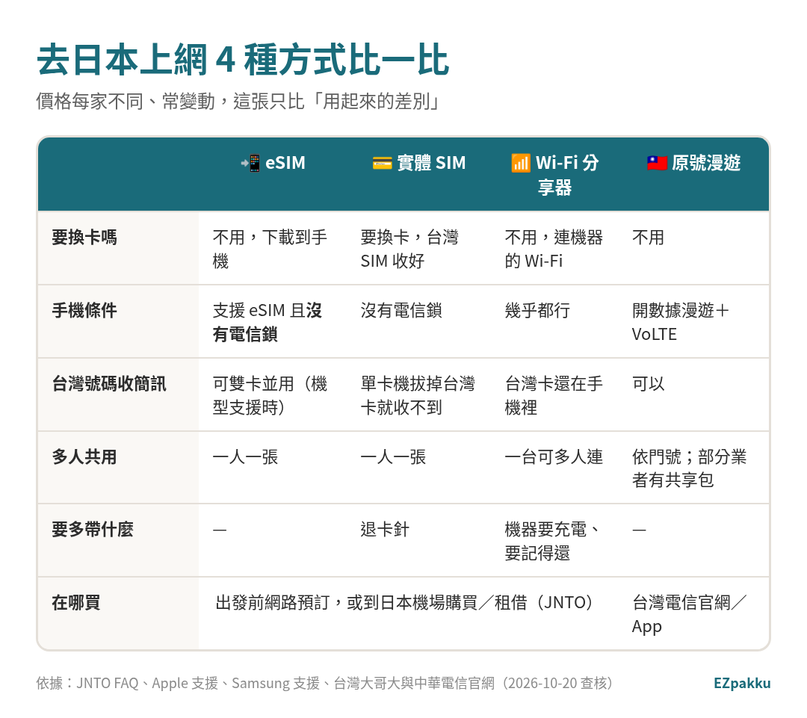
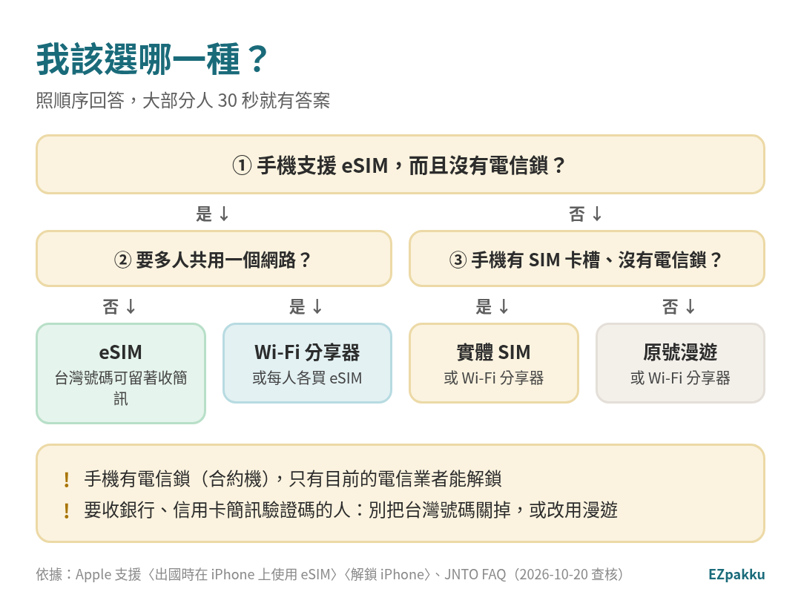
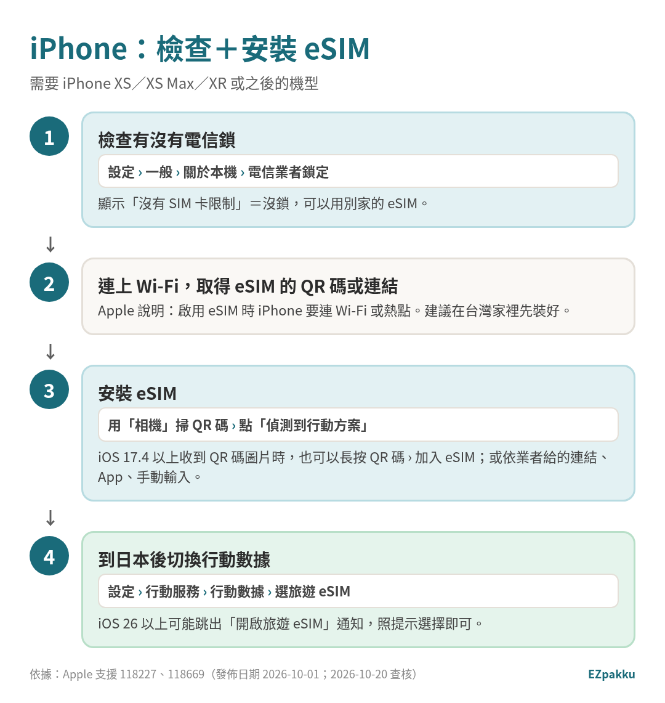
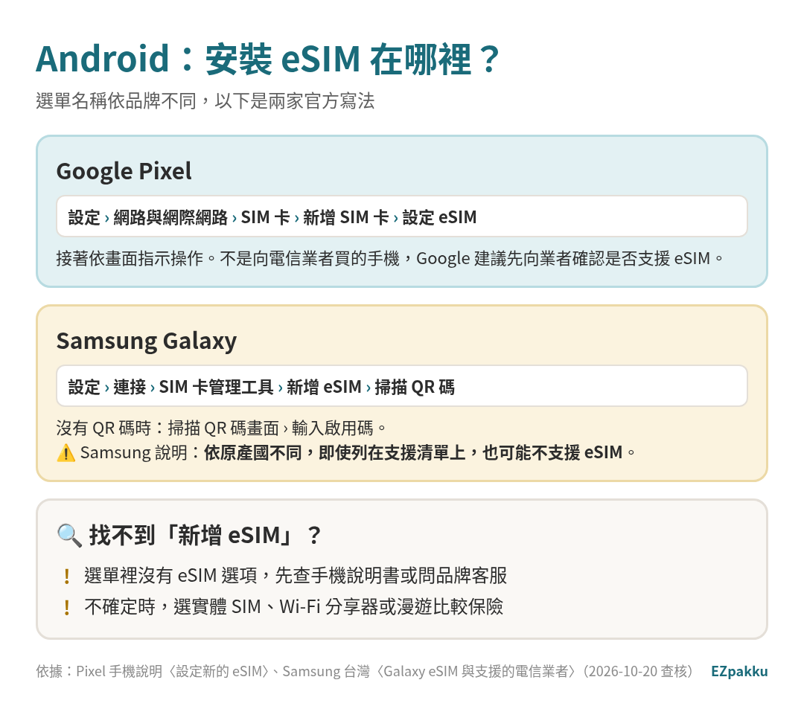
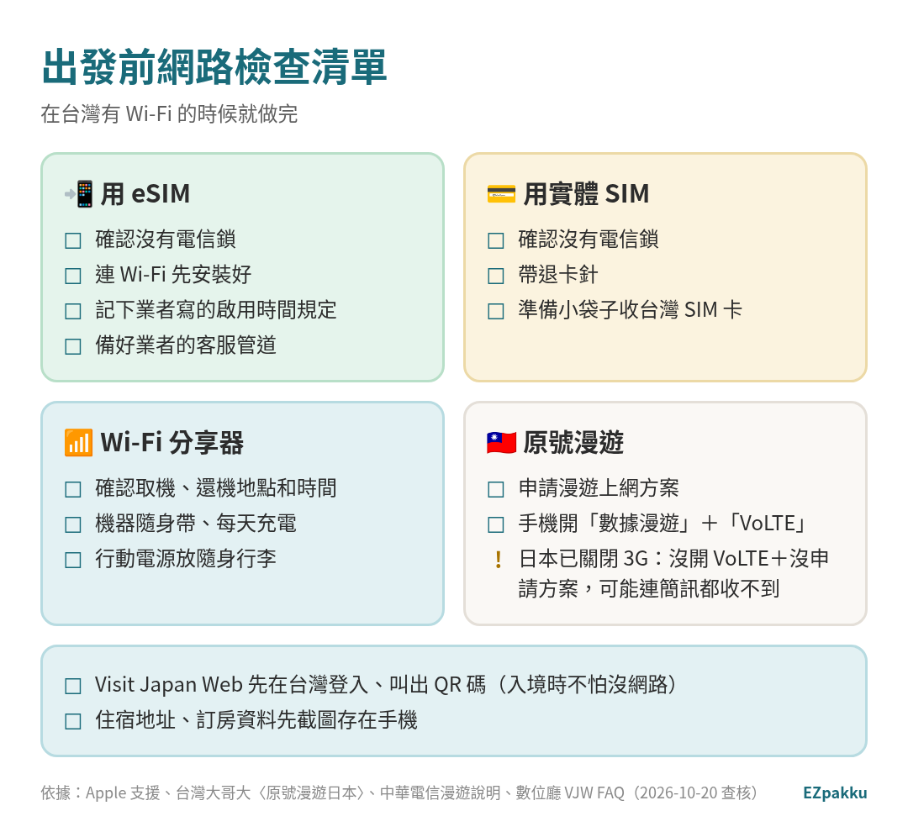

> 📅 資料查核日期：2026-10-20｜內容引用 JNTO、Apple 支援、Google Pixel 說明、Samsung 台灣支援、中華電信、台灣大哥大、遠傳電信官網資料｜**本文不比價**；文中有 1 個推廣連結，已清楚標示

到日本要查地圖、叫出 Visit Japan Web 的 QR 碼、收銀行簡訊驗證碼，手機一定要有網路。JNTO 說，常見的做法是在機場買或租 SIM 卡、eSIM、Wi-Fi 分享器，或出發前上網預訂、到機場取貨；**短期旅客用 eSIM 和 Wi-Fi 分享器特別方便**。[^jnto-faq] 另一種選擇是用台灣電信的原號漫遊。

這篇不比價格（每家不同、變動又快），只講**怎麼選、怎麼檢查手機、怎麼安裝**。

---

## 4 種方式比一比

*圖片來源：EZpakku 自製（依 JNTO FAQ、Apple 支援、Samsung 支援、台灣大哥大與中華電信官網整理）*

| | eSIM | 實體 SIM 卡 | Wi-Fi 分享器 | 原號漫遊 |
|---|---|---|---|---|
| 怎麼用 | 下載到手機裡，不用換卡 [^apple-setup] | 換上日本用的 SIM 卡 | 手機連分享器的 Wi-Fi | 用台灣門號直接上網 |
| 手機條件 | 支援 eSIM，且**沒有電信鎖** [^apple-travel] | 沒有電信鎖 [^apple-travel] | 能連 Wi-Fi 就行 | 開數據漫遊＋VoLTE [^tm-jp][^cht-roam] |
| 台灣號碼收簡訊 | 支援的 iPhone 可同時開兩張 eSIM，或實體卡＋eSIM 並用 [^apple-travel] | 單卡手機拔掉台灣卡就收不到 | 台灣卡仍在手機裡 | 可以（要先開 VoLTE＋申請方案）[^tm-jp] |
| 在哪買 | 出發前網路預訂，或日本機場購買／租借 [^jnto-faq] | 同左 | 同左 | 台灣電信官網、App、門市 [^tm-jp] |

<!-- AFFILIATE: esim（Saily，已放） -->

<aside class="affiliate-box">

推廣連結：透過此連結購買，EZpakku 可能獲得分潤，不影響你的價格

想用 eSIM 的話，可以參考 <a href="https://go.saily.site/aff_c?offer_id=101&amp;aff_id=12246" rel="sponsored nofollow noopener" target="_blank">Saily eSIM</a>。結帳時輸入讀者折扣碼 <strong>Special10</strong> 可打 9 折（實際折扣以 Saily 結帳頁顯示為準）。

買之前，先照下面的步驟確認你的手機支援 eSIM、沒有電信鎖。

</aside>

<!-- AFFILIATE: pocket-wifi -->

---

## 我該選哪一種？

*圖片來源：EZpakku 自製（依 Apple 支援、JNTO FAQ 整理）*

1. **手機支援 eSIM、沒有電信鎖** → 一個人用，選 **eSIM** 最省事；台灣號碼還能留著收簡訊。[^apple-travel]
2. **好幾個人要共用網路** → 考慮 **Wi-Fi 分享器**，或每人各裝一張 eSIM。
3. **手機不支援 eSIM，但有 SIM 卡槽、沒電信鎖** → **實體 SIM 卡**或 Wi-Fi 分享器。
4. **手機有電信鎖，或不想折騰** → **原號漫遊**或 Wi-Fi 分享器。

> 💡 **合約機要注意：** iPhone 有電信鎖時，**只能透過目前的電信業者解鎖**，Apple 也無法幫你解；業者可能需要幾天處理，要提早申請。[^apple-unlock]

---

## 📱 iPhone：檢查＋安裝 eSIM

*圖片來源：EZpakku 自製（依 Apple 支援〈出國時在 iPhone 上使用 eSIM〉〈在 iPhone 上設定 eSIM〉）*

### 1. 確認機型

**iPhone XS、XS Max、XR 或之後的機型**才支援 eSIM。[^apple-travel]

### 2. 確認沒有電信鎖

「設定」›「一般」›「關於本機」，看「**電信業者鎖定**」。顯示「**沒有 SIM 卡限制**」就是沒鎖，可以用其他業者的 eSIM。[^apple-travel]

### 3. 連 Wi-Fi，安裝 eSIM

Apple 說明，啟用 eSIM 時 iPhone 要**連上 Wi-Fi 或熱點**。[^apple-travel] 所以最好**在台灣家裡先裝好**。依業者提供的方式安裝：[^apple-setup]

- **QR 碼：** 打開「相機」掃 QR 碼 → 點「偵測到行動方案」→「繼續」→「加入行動方案」。
- **iOS 17.4 以上，QR 碼在信件或網頁裡：** 長按 QR 碼 →「加入 eSIM」。
- **連結：** 點業者給的連結 → 出現「啟用新的 eSIM」時點「允許」。
- **手動輸入：** 「設定」›「行動服務」›「加入行動方案」›「手動輸入詳細資訊」。

### 4. 到日本後切換行動數據

「設定」›「行動服務」›「行動數據」，選旅遊 eSIM。[^apple-travel]

- iOS 26 以上，抵達時可能跳出「**開啟旅遊 eSIM**」通知，可以選「僅旅遊 eSIM」或「旅遊 eSIM 和目前的 eSIM」。[^apple-travel]
- 兩個號碼都開時，台灣號碼**仍可能產生漫遊費用**。[^apple-travel]
- 只開旅遊 eSIM 時，FaceTime 和 iMessage 會繼續用台灣號碼。[^apple-travel]
- 回國後，iOS 26 以上可能會自動關閉旅遊 eSIM；沒有的話，到「行動服務」確認台灣號碼已開啟，並關掉不用的旅遊 eSIM。[^apple-travel]

---

## 🤖 Android：安裝 eSIM 在哪裡？

*圖片來源：EZpakku 自製（依 Pixel 手機說明〈設定新的 eSIM〉、Samsung 台灣〈Galaxy eSIM 與支援的電信業者〉）*

Android 的選單名稱依品牌不同。以下是兩家官方的寫法：

- **Google Pixel：** 「設定」›「網路與網際網路」›「SIM 卡」›「新增 SIM 卡」›「設定 eSIM」，再依畫面指示操作。[^pixel-esim]
  - 不是向電信業者買的手機，Google 建議先向業者確認是否支援 eSIM。[^pixel-esim]
- **Samsung Galaxy：** 「設定」›「連接」›「SIM 卡管理工具」›「新增 eSIM」›「掃描 QR 碼」；沒有 QR 碼就在掃描畫面選「輸入啟用碼」。[^samsung-esim]
  - ⚠️ Samsung 說明：**依原產國不同，即使機型列在支援清單上，也可能不支援 eSIM。**[^samsung-esim]
- **其他品牌：** 選單裡找不到 eSIM 選項時，先查說明書或問品牌客服。**這裡不列出未經官方確認的檢查方法。**

---

## 🇹🇼 用台灣門號原號漫遊

各家方案和價格常變動，請直接看官網：[^cht-roam][^tm-jp][^fet-jp]

- 中華電信：國際漫遊方案頁
- 台灣大哥大：原號漫遊日本
- 遠傳電信：日本原號漫遊出國上網

<!-- AFFILIATE: roaming -->

**一定要做的設定：**

- 台灣大哥大官網提醒：**日本業者已終止 3G 網路**，手機沒開 **VoLTE**、也沒申請漫遊上網方案的話，**在當地無法使用漫遊服務，連收發簡訊都不行**。出國前要開「數據漫遊」和「VoLTE」，並申請漫遊上網方案。[^tm-jp]
- 中華電信的出國前檢查也寫：開啟「數據漫遊」與「VoLTE」。[^cht-roam]
- 只想收簡訊、接電話的人，台灣大哥大建議同時開 VoLTE 和 Wi-Fi Calling，並開飛航模式，透過當地 Wi-Fi 使用。[^tm-jp]

---

## ✅ 出發前檢查清單

*圖片來源：EZpakku 自製（依 Apple 支援、台灣大哥大、中華電信、數位廳 VJW FAQ 整理）*

- **eSIM 在台灣有 Wi-Fi 時就裝好。**[^apple-travel]
- **Visit Japan Web 先登入。** 事先上網登入並保持登入，到日本沒網路也能叫出入境 QR 碼。[^vjw-faq] 👉 [VJW 圖解教學](/zh-tw/blog/visit-japan-web/)
- **要收銀行、信用卡簡訊驗證碼的人：** 別把台灣號碼關掉。用 eSIM 時可以兩個號碼並用；[^apple-travel] 用漫遊要先開 VoLTE。[^tm-jp]
- **Wi-Fi 分享器、行動電源放隨身行李。** 行動電源不能託運。👉 [打包技巧：分包和封箱法](/zh-tw/blog/packing-tips-bags-sealing/)

## ⚠️ 常見錯誤

1. **合約機買了 eSIM 才發現有電信鎖。** 先看「電信業者鎖定」。[^apple-travel]
2. **到日本才裝 eSIM，結果沒有 Wi-Fi。** 啟用時要連網。[^apple-travel]
3. **漫遊沒開 VoLTE。** 日本 3G 已關閉，可能連簡訊都收不到。[^tm-jp]
4. **兩個號碼都開著，台灣號碼被收漫遊費。** 依方案而定，出發前問清楚。[^apple-travel]
5. **以為 Android 都支援 eSIM。** 依機型和原產國不同。[^samsung-esim]

---

## 常見問題 FAQ

**Q1：eSIM 和實體 SIM 卡哪個比較好？**
Apple 列出的 eSIM 好處是：手機遺失時 eSIM 不能被拔走、不用等卡片寄送、不怕弄丟小卡、支援機型可同時開兩張 eSIM。[^apple-travel] 手機不支援 eSIM 就只能用實體卡。

**Q2：買 eSIM 要護照嗎？**
Apple 說明，依當地規定，向當地業者購買時**可能需要出示證件（如護照）**。[^apple-travel] 每家業者規定不同。

**Q3：哪家 eSIM 最便宜？**
**本文不比價。** 價格、流量、天數算法每家都不同又常變動，請以各業者官網為準。

**Q4：一台 Wi-Fi 分享器可以幾個人用？**
依機器和業者而定，**官方資料沒有統一規定**，請看租借業者的說明。

**Q5：日本機場有免費 Wi-Fi 嗎？**
數位廳的 VJW 說明書提到可以用機場的免費 Wi-Fi 來編輯同行家人資料。[^vjw-manual] 其他機場的 Wi-Fi 狀況，請看各機場官網。

---

> 🧳 **網路搞定了，行李呢？** 用 [**EZpakku**](/zh-tw/) 產生日本行李清單，充電器、行動電源、分享器都不會漏。看看完整的 👉 [日本行李清單](/zh-tw/blog/japan-packing-list/)

---

## 📚 延伸閱讀

- [手機 10 分鐘搞定 Visit Japan Web（入境、海關 QR 碼）](/zh-tw/blog/visit-japan-web/)
- [日本行李清單：去日本要帶什麼](/zh-tw/blog/japan-packing-list/)
- [日本免稅怎麼買、怎麼退（2026/11/1 新制）](/zh-tw/blog/japan-tax-free-refund/)
- [打包技巧：分包和封箱法](/zh-tw/blog/packing-tips-bags-sealing/)

---

## 資料來源（查核日期：2026-10-20）

[^jnto-faq]: JNTO〈FAQ〉（How should I arrange a SIM card, eSIM, or Wi-Fi in Japan?） https://www.japan.travel/en/faq/
[^apple-travel]: Apple 支援〈出國時在 iPhone 上使用 eSIM〉（發佈日期 2026-10-01） https://support.apple.com/zh-tw/118227
[^apple-setup]: Apple 支援〈在 iPhone 上設定 eSIM〉（發佈日期 2026-10-01） https://support.apple.com/zh-tw/118669
[^apple-unlock]: Apple 支援〈如何解鎖 iPhone 以搭配其他電信業者使用〉 https://support.apple.com/zh-tw/109316
[^pixel-esim]: Pixel 手機說明〈設定新的 eSIM〉 https://support.google.com/pixelphone/answer/16115470?hl=zh-hant
[^samsung-esim]: Samsung 台灣〈Galaxy eSIM 與支援的電信業者〉（最後更新 2026-09-21） https://www.samsung.com/tw/support/mobile-devices/galaxy-esim-and-supported-network-carriers/
[^cht-roam]: 中華電信〈出國手機上網，國際漫遊方案都在這〉（含出國前設定檢查） https://www.cht.com.tw/home/campaign/roamingplan/index
[^tm-jp]: 台灣大哥大〈原號漫遊日本〉 https://www.taiwanmobile.com/travel/postpaid-roaming-jp.html
[^fet-jp]: 遠傳電信〈日本原號漫遊出國上網〉 https://www.fetnet.net/content/cbu/tw/promotion/roaming/jp.html
[^vjw-faq]: Visit Japan Web〈常見問題（FAQ）〉 https://www.vjw.digital.go.jp/main/#/vjwpco011-zh-cmn-Hant
[^vjw-manual]: 《Visit Japan Web 操作說明書》（繁體中文）附頁「離線狀態使用」 https://www.vjw.digital.go.jp/manual/main/visitjapanweb_manual_zh-cmn-Hant.html

> 本文只整理官方公開資料，不含任何導購連結；方案與價格以各業者官網為準。
