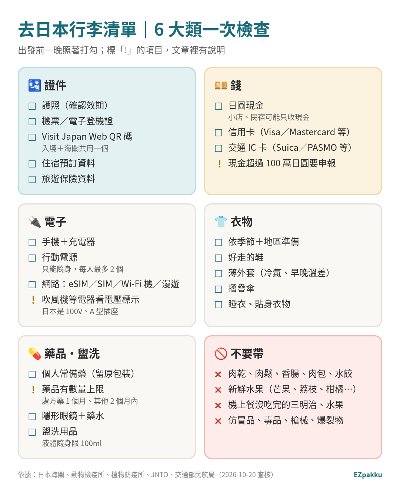
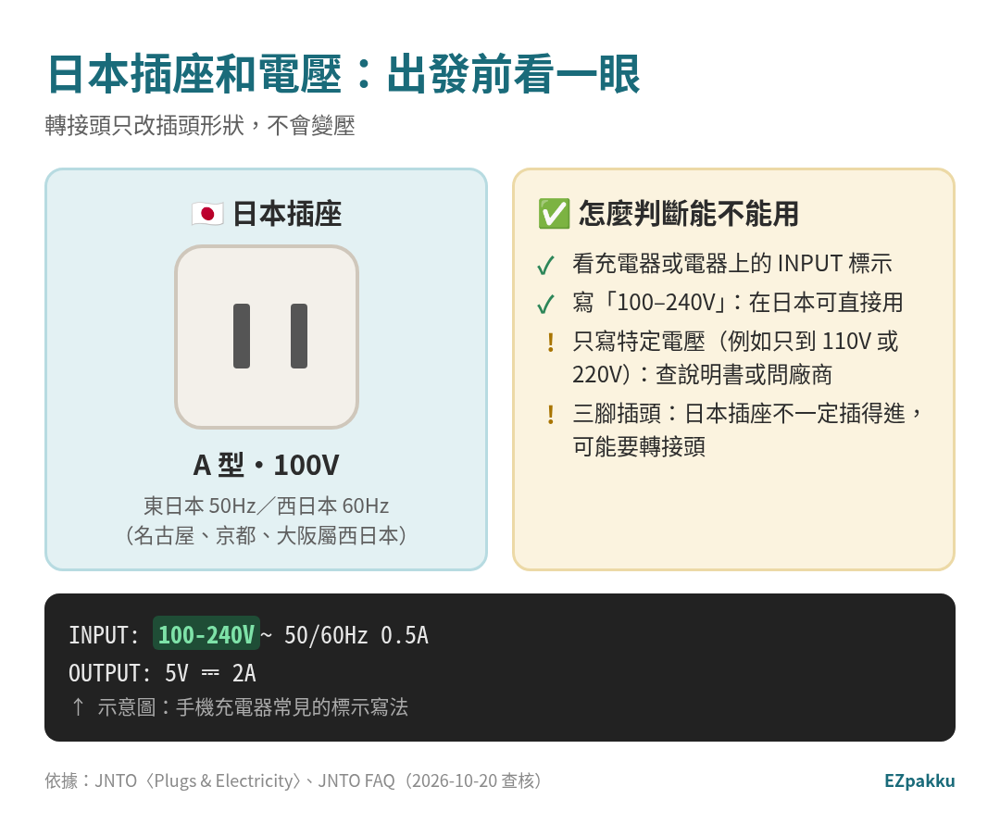
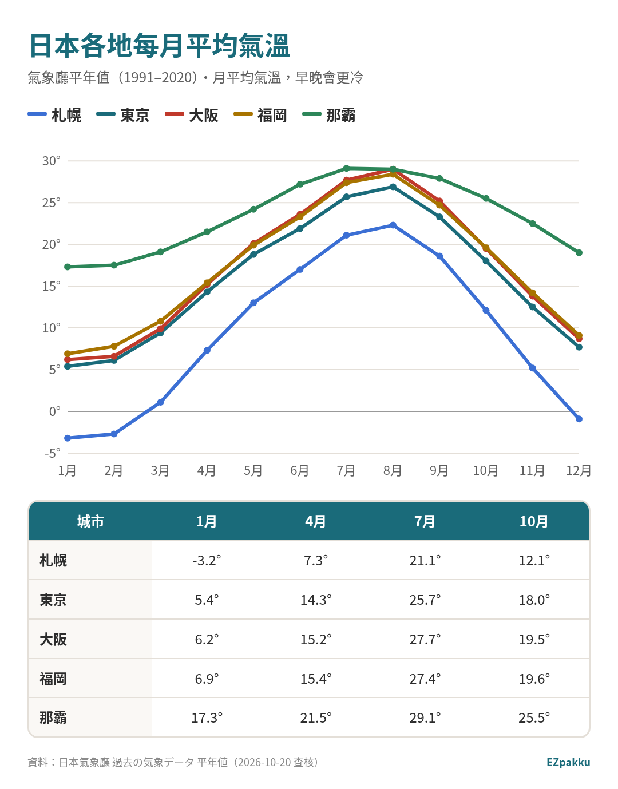
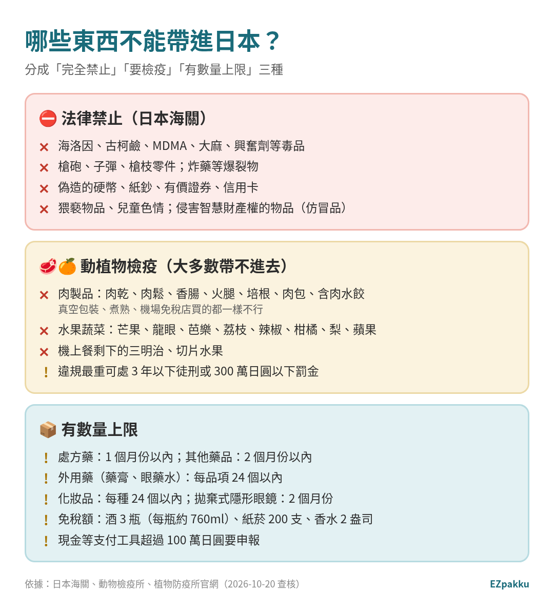

> 📅 資料查核日期：2026-10-20｜引用日本海關、農林水產省動物檢疫所與植物防疫所、JNTO（日本國家旅遊局）、日本氣象廳、交通部民航局等官方資料

出發前一晚才在想「護照呢？轉接頭要不要帶？肉乾可以帶給日本朋友嗎？」這篇把去日本要帶的東西分成 6 大類，順便整理**哪些東西帶進日本會被沒收甚至罰款**。照著打勾，就不會漏東西。

---

## 一張圖看完：日本行李清單 6 大類

*圖片來源：EZpakku 自製（依日本海關、動物檢疫所、植物防疫所、JNTO、交通部民航局資料整理）*

<!-- AFFILIATE: shopee — 蝦皮推廣者編碼 16375200009。待 RY 選定商品後才放連結（rel="sponsored nofollow noopener"＋推廣連結標示），不要自己編商品網址 -->

> 💡 **想直接拿到可以打勾的版本？** 用 [**EZpakku**](/zh-tw/) 選「日本」和天數，就會產生清單，還能把東西分到不同包包裡。

---

## 🛂 證件

- **護照。** 先確認效期。Visit Japan Web 登錄護照時，效期不到 6 個月系統會跳出警告。[^vjw-guide]
- **Visit Japan Web（VJW）的 QR 碼。** 入境審查和海關申報共用同一個 QR 碼，出發前先在家用手機填好。[^vjw-news-qr] 怎麼填請看 👉 [手機 10 分鐘搞定 Visit Japan Web](/zh-tw/blog/visit-japan-web/)
- **機票、住宿資料。** VJW 登錄入境預定時會用到航班號碼和住宿地址、電話。[^vjw-manual]

## 💴 錢：現金還是信用卡？

JNTO 的說法很直接：[^jnto-faq]

- 大多數商店和餐廳都收 Visa、Mastercard 等信用卡，**但日本仍是現金文化**。
- **小店和民宿（guest house）可能只收現金**，建議抵達前先準備一些日圓現金。
- 到了日本，ATM 到處都有，可以視需要提領。

搭電車、公車可以買票，也可以用 Suica、PASMO 等交通 IC 卡。[^jnto-faq]

> ⚠️ **現金帶很多的人注意：** 攜帶現金（含外幣）、支票、有價證券等合計**超過 100 萬日圓**，入境時要向日本海關申報。[^customs-passenger]

## 🔌 電子產品：日本是 100V、A 型插座

*圖片來源：EZpakku 自製（依 JNTO〈Plugs & Electricity〉與 JNTO FAQ）；充電器標示為示意*

- 日本全國電壓都是 **100V**，頻率東日本 50Hz、西日本 60Hz（名古屋、京都、大阪屬西日本）。[^jnto-plug]
- 插座是 **A 型**（兩根扁腳），從國外來可能需要轉接頭。[^jnto-faq]
- 雙電壓的吹風機、旅行用熨斗、刮鬍刀在日本各地應該都能用；其他電器可能需要降壓器。[^jnto-plug]
- **怎麼判斷？** 看電器上的 INPUT 標示。寫「100–240V」就是雙電壓。三腳插頭插不進兩孔插座時，要準備轉接頭。
- 轉接頭和變壓器在秋葉原、大阪日本橋或 Yodobashi、Bic Camera 等大型家電量販店買得到。[^jnto-plug]
- **行動電源只能放隨身行李，每人最多 2 個。** 詳細規定看 👉 [打包技巧：分包和封箱法](/zh-tw/blog/packing-tips-bags-sealing/)
- **網路怎麼辦？** eSIM、SIM 卡、Wi-Fi 分享器、原號漫遊怎麼選，看 👉 [日本 eSIM 和網卡怎麼選](/zh-tw/blog/japan-esim-wifi/)

想把手機掛在身上、順便少帶一條充電線的話，可以參考這種掛繩和充電線合一的款式：

[[商品:polywell-lanyard]]

## 👕 衣物：看季節，也看地區

日本南北溫差很大。同樣是 1 月，札幌平均 -3.2°C，那霸卻有 17.3°C。[^jma-sapporo][^jma-naha]

*圖片來源：EZpakku 自製（資料：日本氣象廳 1991–2020 年平年值）*

| 城市 | 1 月 | 4 月 | 7 月 | 10 月 |
|---|---|---|---|---|
| 札幌 | -3.2°C | 7.3°C | 21.1°C | 12.1°C |
| 東京 | 5.4°C | 14.3°C | 25.7°C | 18.0°C |
| 大阪 | 6.2°C | 15.2°C | 27.7°C | 19.5°C |
| 福岡 | 6.9°C | 15.4°C | 27.4°C | 19.6°C |
| 那霸 | 17.3°C | 21.5°C | 29.1°C | 25.5°C |

*表中是月平均氣溫，早晚的最低溫會更低（例如東京 1 月日最低氣溫平年值 1.2°C）。*[^jma-tokyo]

我的建議：

- **先查目的地的月平均氣溫，再決定外套厚度。** 出發前幾天再看一次天氣預報。
- **薄外套幾乎四季都帶。** 室內冷氣、早晚溫差都用得到。
- **好走的鞋一定要。** 日本行程常常一天走很多路。
- **衣服件數：** EZpakku 會依天數算衣服數量（最多算 7 天份，超過建議在當地洗衣）。

## 💊 藥品、盥洗用品

- **藥品有數量上限。** 不用另外申請、在海關就能通關的範圍是：[^customs-9005]
  - 處方藥、毒藥、劇藥：**1 個月份以內**
  - 其他藥品、醫藥部外品：**2 個月份以內**
  - 外用藥（藥膏、眼藥水等，處方藥除外）：**每品項 24 個以內**
  - 化妝品：**每種 24 個以內**；拋棄式隱形眼鏡：**2 個月份以內**
- **含特定成分的藥要特別小心。** 興奮劑（覺醒劑）就算是治療用也不能帶進日本；醫療用麻藥、精神藥物有另外的規定。[^customs-9005] 例如含麻黃素（ephedrine）的藥，**含量超過 10%** 在日本屬於「覺醒劑原料」，要事前向厚生勞動省麻藥取締部申請許可，入境日 2 週前要送件。[^ncd-guide] 不確定的話，先問醫師或藥師。
- **液體隨身限 100ml。** 搭國際線，隨身的液體、膠狀、噴霧類每瓶不能超過 100 毫升，全部裝進 1 個 1 公升以內的透明夾鏈袋，每人 1 袋。[^caa-liquid]

---

## 🚫 哪些東西不能帶進日本？

*圖片來源：EZpakku 自製（依日本海關、動物檢疫所、植物防疫所官網）*

### 1. 法律禁止帶進日本的東西

日本海關列出的禁止進口物品：[^customs-prohibit]

- 海洛因、古柯鹼、MDMA、鴉片、大麻、興奮劑、精神藥物等毒品
- 手槍等槍砲、子彈、槍枝零件
- 炸藥、火藥等爆裂物；化學武器原料；可能用於生物恐怖攻擊的病原體
- 偽造或變造的硬幣、紙鈔、有價證券、信用卡
- 猥褻物品、兒童色情
- 侵害智慧財產權的物品（例如仿冒品）

### 2. 肉製品和水果：大多數都帶不進去

這是台灣旅客最容易踩雷的地方。

- **肉製品：** 肉乾、肉鬆、香腸、火腿、培根、肉包、含肉水餃、雞爪、漢堡、火腿三明治等，**原則上都不能帶進日本**。[^pps-request]
  - 真空包裝、煮熟、機場免稅店買的、有日文標示的，**都一樣不行**。[^pps-request][^aqs-import]
- **水果蔬菜：** 芒果、龍眼、芭樂、荔枝、辣椒、柑橘、梨、蘋果等，大多數都禁止帶入。[^pps-request]
- **機上餐：** 沒吃完的三明治、切片水果也不能帶下飛機，請在機上吃完。[^pps-request]
- **罰則：** 違規帶入可處 **3 年以下徒刑或 300 萬日圓以下罰金**（法人最高 5,000 萬日圓），也有人因此被逮捕。[^pps-request][^aqs-import]
- **魚乾：** 不含畜肉和蛋的魚乾、水產加工品不屬於動物檢疫範圍，但檢疫官可能會檢查確認不含肉。[^aqs-import]

### 3. 有數量上限的東西（免稅額）

成人旅客帶進日本、不用繳稅的範圍：[^customs-passenger]

| 品項 | 免稅範圍 |
|---|---|
| 酒 | 3 瓶（每瓶約 760ml） |
| 紙菸 | 200 支（加熱菸 10 包；雪茄 50 支） |
| 香水 | 2 盎司（1 盎司約 28ml） |
| 其他物品 | 海外市價合計 20 萬日圓以內（單件 1 萬日圓以下的不算進去） |

---

## ✅ 實用技巧

- **證件、錢、藥、充電器放隨身包。** 託運行李延誤也不怕。
- **VJW 先在家填好。** 先登入過、保持登入狀態，到日本沒網路也能叫出 QR 碼。[^vjw-faq]
- **伴手禮避開肉類和生鮮蔬果。** 買之前看成分表，含肉的醬料、零食、泡麵都可能被沒收。[^pps-request]
- **藥品留原包裝。** 被問的時候比較好說明。
- **回程要退稅的人：** 2026/11/1 起日本免稅改成「先付後退」，免稅品要在託運之前帶去機場機台。詳細看 👉 [日本免稅怎麼買、怎麼退](/zh-tw/blog/japan-tax-free-refund/)

## ⚠️ 常見錯誤

1. **帶肉乾、肉鬆、香腸給日本朋友。** 真空包裝也不行。[^pps-request]
2. **機上餐的水果、三明治帶下飛機。**[^pps-request]
3. **把行動電源放託運行李。** 只能隨身。[^caa-dg]
4. **只帶信用卡、沒帶現金。** 小店、民宿可能只收現金。[^jnto-faq]
5. **帶了只能用特定電壓的電器。** 先看 INPUT 標示。[^jnto-plug]
6. **常備藥帶太多。** 處方藥 1 個月份、其他藥 2 個月份為限。[^customs-9005]

---

## 常見問題 FAQ

**Q1：台灣的插頭在日本可以直接用嗎？**
日本插座是 A 型、電壓 100V。[^jnto-faq] 兩腳扁插頭通常插得進去；三腳插頭可能需要轉接頭。電器能不能用，看 INPUT 標示有沒有涵蓋 100V。

**Q2：鳳梨酥可以帶去日本嗎？**
官方資料限制的是「肉製品」和「水果蔬菜」等。[^pps-request] 鳳梨酥這類加工點心，**我沒有查到官方單獨說明**，只要確認內餡沒有肉就好；含肉鬆的口味不行。

**Q3：泡麵可以帶嗎？**
官方說明是「只要用到肉的產品都不能帶」。[^pps-request] 調味包含肉的泡麵**可能被沒收**，最保險是不要帶。

**Q4：要帶多少日圓現金？**
官方沒有建議金額。JNTO 只建議抵達前先準備一些日圓現金，到日本後 ATM 也很多。[^jnto-faq]

**Q5：Visit Japan Web 一定要填嗎？**
官方資料查不到「強制使用」的說法，但填好可以讓入境更順。詳見 👉 [VJW 圖解教學](/zh-tw/blog/visit-japan-web/)

---

> 🧳 **照著這篇一項一項打勾太麻煩？** 用 [**EZpakku**](/zh-tw/) 選「日本」、天數和季節，自動產生清單，再把東西分到隨身包、登機箱、託運箱，裝完一包就「封箱」。

---

## 📚 延伸閱讀

- [手機 10 分鐘搞定 Visit Japan Web（入境、海關 QR 碼）](/zh-tw/blog/visit-japan-web/)
- [日本免稅怎麼買、怎麼退（2026/11/1 新制）](/zh-tw/blog/japan-tax-free-refund/)
- [日本 eSIM 和網卡怎麼選](/zh-tw/blog/japan-esim-wifi/)
- [打包技巧：分包和封箱法](/zh-tw/blog/packing-tips-bags-sealing/)

---

## 資料來源（查核日期：2026-10-20）

[^vjw-guide]: 日本數位廳〈Visit Japan Web 使用方法〉 https://services.digital.go.jp/zh-cmn-hant/visit-japan-web/guide/
[^vjw-news-qr]: 日本數位廳〈統一了入境審查和海關申報的二維碼〉（2024/1/25） https://services.digital.go.jp/zh-cmn-hant/visit-japan-web/news/20240125-01/
[^vjw-manual]: 《Visit Japan Web 操作說明書》（繁體中文）第 4 章 登錄入境、回國預定 https://www.vjw.digital.go.jp/manual/main/visitjapanweb_manual_zh-cmn-Hant.html
[^vjw-faq]: Visit Japan Web〈常見問題（FAQ）〉 https://www.vjw.digital.go.jp/main/#/vjwpco011-zh-cmn-Hant
[^jnto-faq]: JNTO〈FAQ〉（電壓與插頭、信用卡與現金、交通 IC 卡） https://www.japan.travel/en/faq/
[^jnto-plug]: JNTO〈Japan Electrical Outlet（Plugs & Electricity）〉 https://www.japan.travel/en/plan/plug-and-electricity/
[^customs-passenger]: 日本海關〈Procedures of Passenger Clearance〉（免稅額、現金申報） https://www.customs.go.jp/english/summary/passenger.htm
[^customs-prohibit]: 日本海關〈Goods with Prohibitions, Controls and Restrictions〉 https://www.customs.go.jp/english/summary/prohibit.htm
[^customs-9005]: 日本海關〈9005 海外旅行者向け（医薬品・化粧品等）〉 https://www.customs.go.jp/tetsuzuki/c-answer/sonota/9005_jr.htm
[^ncd-guide]: 厚生勞動省 地方厚生局麻藥取締部〈医薬品である覚醒剤原料の携帯輸入・輸出の手引き〉 https://www.ncd.mhlw.go.jp/dl_data/keitai/guide_srm_jp20241212.pdf （總覽頁：https://www.ncd.mhlw.go.jp/shinsei6.html ）
[^pps-request]: 農林水產省 植物防疫所〈Request to people coming to Japan〉 https://www.maff.go.jp/pps/j/pqaqinfo_en.html
[^aqs-import]: 農林水產省 動物檢疫所〈Bringing animal products into Japan from overseas〉 https://www.maff.go.jp/aqs/english/product/import.html
[^caa-liquid]: 行政院公報〈交通部民用航空局公告：其他有影響飛航安全之虞不得攜帶進入航空器之物品名稱〉（106/3/22） https://gazette.nat.gov.tw/EG_FileManager/eguploadpub/eg023052/ch06/type1/gov50/num18/Eg.htm
[^caa-dg]: 交通部民用航空局〈旅客及組員可攜帶或託運上機之危險物品表〉 https://www.caa.gov.tw/FileAtt.ashx?id=40793&lang=1
[^jma-tokyo]: 日本氣象廳〈過去の気象データ検索：東京 平年値（1991–2020）〉 https://www.data.jma.go.jp/obd/stats/etrn/view/nml_sfc_ym.php?prec_no=44&block_no=47662
[^jma-sapporo]: 日本氣象廳〈札幌 平年値〉 https://www.data.jma.go.jp/obd/stats/etrn/view/nml_sfc_ym.php?prec_no=14&block_no=47412
[^jma-naha]: 日本氣象廳〈那覇 平年値〉 https://www.data.jma.go.jp/obd/stats/etrn/view/nml_sfc_ym.php?prec_no=91&block_no=47936

> 另外兩個城市的氣溫資料：大阪 https://www.data.jma.go.jp/obd/stats/etrn/view/nml_sfc_ym.php?prec_no=62&block_no=47772 ／福岡 https://www.data.jma.go.jp/obd/stats/etrn/view/nml_sfc_ym.php?prec_no=82&block_no=47807
>
> 本文只整理官方公開資料，規定隨時可能變更，出發前請以官網最新公告為準。
