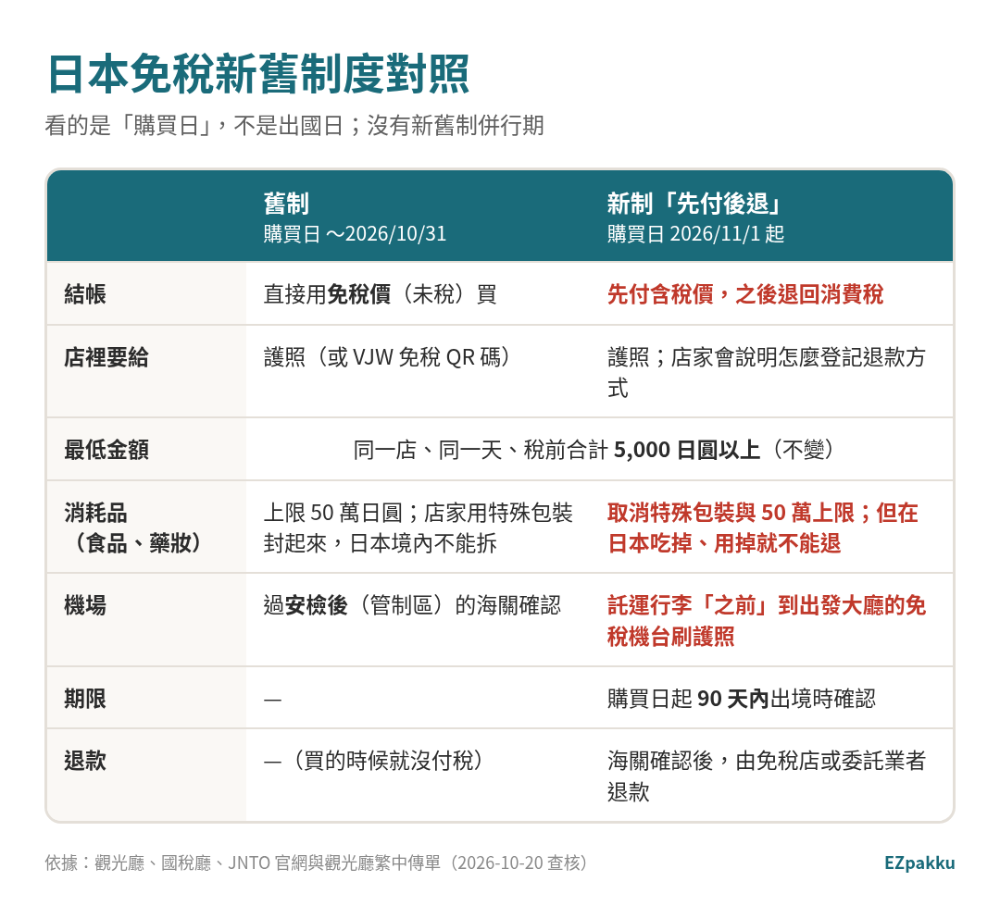
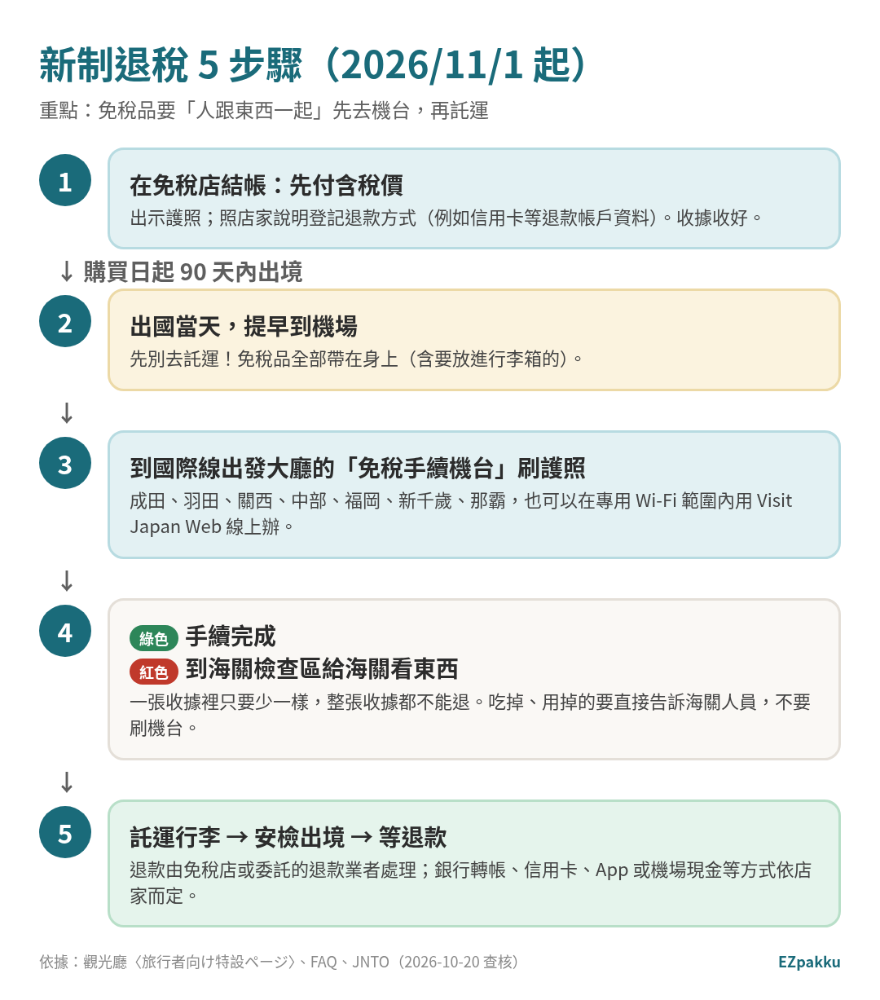
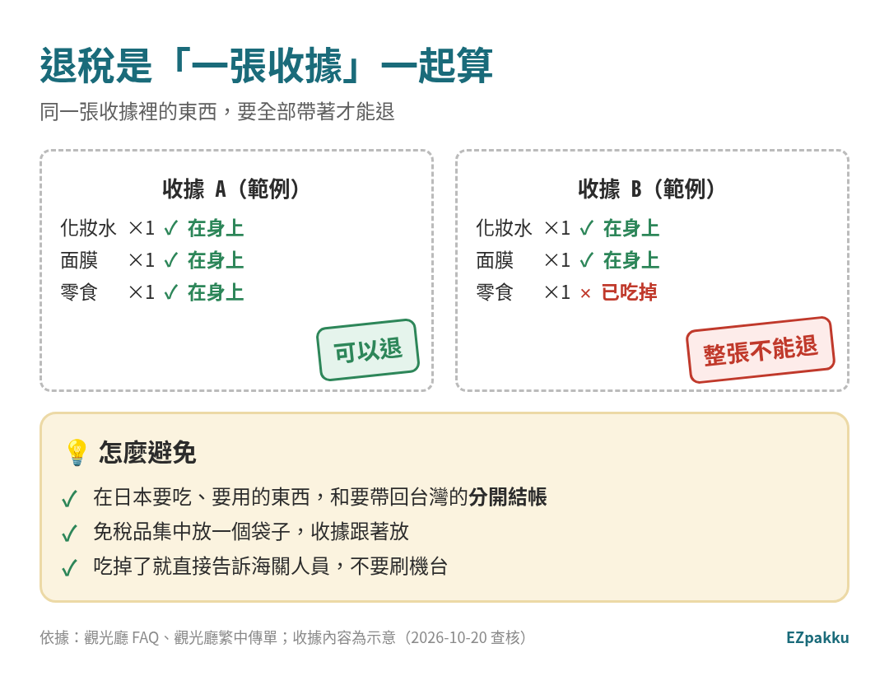
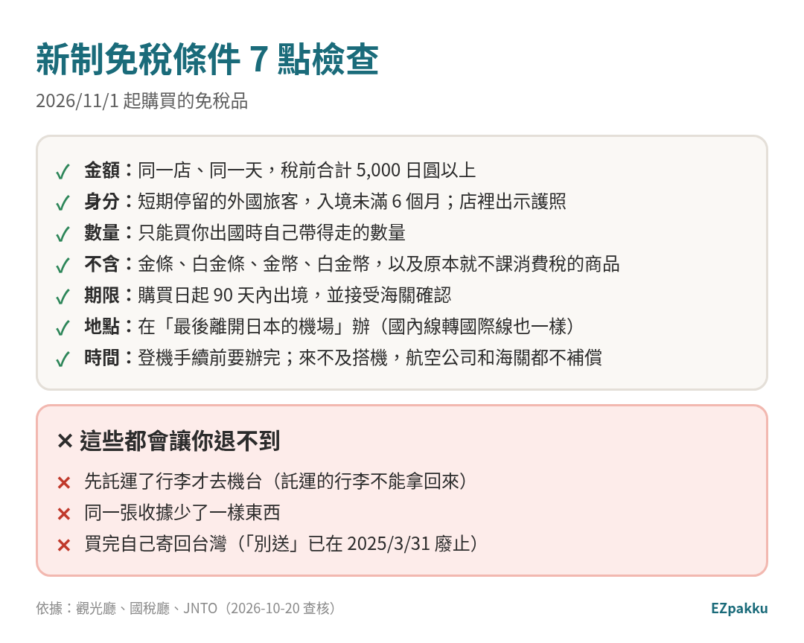

> 📅 資料查核日期：2026-10-20｜內容引用日本觀光廳、國稅廳、JNTO、日本海關的官方資料

去日本買藥妝、電器，以前在店裡出示護照就能直接用免稅價結帳。**從 2026 年 11 月 1 日購買的商品開始，規則改了**：結帳時要先付含稅價，回國那天到機場給海關確認後，才把消費稅退給你。[^kankocho-traveler][^nta-qa]

最容易踩雷的一點：**免稅品要在「託運行李之前」帶去機場的免稅機台**。先託運就退不到了。這篇用圖一步一步講清楚。

---

## 先看結論：新舊制差在哪？

*圖片來源：EZpakku 自製（依觀光廳〈手続の変更点（比較表）〉、旅行者特設頁、繁體中文傳單、國稅廳 Q&A 整理）*

| | 舊制（購買日 ～2026/10/31） | 新制（購買日 2026/11/1 起） |
|---|---|---|
| 結帳 | 直接用免稅價（未稅）買 | **先付含稅價** [^kankocho-traveler] |
| 最低金額 | 同一店、同一天，稅前 5,000 日圓以上 | **不變** [^kankocho-compare] |
| 消耗品（食品、化妝品、藥品等） | 上限 50 萬日圓，特殊包裝封起來、日本境內不能拆 [^kankocho-current] | **取消特殊包裝和 50 萬上限**，但在日本吃掉、用掉就不能退 [^kankocho-traveler][^kankocho-compare] |
| 機場確認 | 在安檢後（管制區）的海關確認 [^leaflet-tc] | **託運行李前**，到出發大廳的免稅手續機台 [^kankocho-traveler] |
| 期限 | — | **購買日起 90 天內**出境時確認 [^kankocho-traveler] |
| 退款 | 不需要（結帳時就沒付稅） | 海關確認後，由免稅店或委託的退款業者退款 [^kankocho-traveler] |

### ⚠️ 看的是「購買日」，不是出國日

國稅廳說明：新制從 **2026 年 11 月 1 日凌晨 0 點以後**在免稅店的銷售開始適用，**看購買日，不是出國日**，而且**沒有新舊制併行的過渡期**。[^nta-qa]

所以如果你的行程跨過 11/1：

- 10/31 以前買的 → 舊制（結帳時就免稅）
- 11/1 以後買的 → 新制（先付含稅價，出境時退）

> 機場端怎麼同時處理兩種收據，**官方的旅客說明頁沒有寫**。建議兩種收據分開放，到機場有疑問直接問海關人員。

---

## 新制退稅 5 步驟

*圖片來源：EZpakku 自製（依觀光廳旅行者特設頁、旅行者 FAQ、JNTO 說明整理）*

### STEP 1｜在免稅店結帳：先付含稅價

- 出示**護照**。短期停留的外國旅客，要能確認入境日本未滿 6 個月。[^kankocho-eligible]
- 結帳時付**含稅價**。[^kankocho-traveler]
- **退款方式會在購買時說明。** 觀光廳的繁中傳單寫的是「登記信用卡等退稅帳戶資料」；實際怎麼登記，問店家或店家介紹的退款業者。[^leaflet-tc][^kankocho-faq]
- 店家必須告訴你：90 天內出境時要在海關出示護照確認、海關要求時要出示商品、確認後要儘快帶出國。[^nta-refund]

### STEP 2｜出國當天：提早到機場，先別託運

- **所有免稅品都要帶在身上**，包括你原本打算放進行李箱託運的那些。[^kankocho-traveler]
- 機台設在**行李託運之前**的國際線出發大廳。行李一旦託運，**不能為了辦免稅再拿回來**。[^kankocho-faq]
- 登機手續前要辦完（包含被抽到檢查的時間）。**因為來不及而沒搭上飛機，航空公司和海關都不補償。**[^kankocho-traveler]

### STEP 3｜到免稅手續機台刷護照

- 在**購買日起 90 天內**出境時，把護照放到機台（KIOSK 或電子終端）上。[^kankocho-traveler]
- 機台作業本身只要幾秒鐘。[^kankocho-faq]
- 國內線轉國際線的人，要在**最後離開日本的機場**辦。[^kankocho-traveler]

### STEP 4｜看結果：綠色或紅色

- 🟢 **綠色：** 不用檢查，手續完成。[^kankocho-traveler]
- 🔴 **紅色：** 帶著免稅品到海關檢查區，給海關確認。[^kankocho-traveler]
- 稅前單價 **100 萬日圓以上**的商品，海關可能要你一起出示鑑定書或保證書。[^kankocho-faq]

### STEP 5｜託運行李、出境，等退款

- 海關確認完，就可以去託運了。
- **退款由免稅店或委託的退款業者處理**，原則上是在機場海關確認、免稅成立之後退。[^kankocho-faq]
- 退款方式**依店家不同**，官方舉的例子有：銀行轉帳、信用卡、App，或在機場用現金退款。[^kankocho-faq][^nta-refund]
- **退款手續費：官方未說明**，依店家或退款業者而定。

<strong>📄 觀光廳繁體中文傳單</strong> <small>這裡原本放官方傳單圖片，取得轉載許可前先不放。想看原文可以直接打開觀光廳的 <a href="https://www.mlit.go.jp/kankocho/tax-free/content/001991249.pdf" target="_blank" rel="noopener">繁體中文傳單 PDF</a>。</small>

---

## 📱 Visit Japan Web 可以幫上什麼？

- **出境時：** 成田、羽田、關西、中部、福岡、新千歲、那霸這 7 個機場，可以在國際線出發大廳的**免稅手續專用 Wi-Fi 範圍內（安檢前）**，用 Visit Japan Web 線上辦，代替機台。[^kankocho-traveler]
- **購物時：** 舊制下，在 VJW 產生「免稅 QR 碼」，到有 VJW 標誌的店出示就能辦免稅，但不是每家都接受。[^kankocho-current] 觀光廳繁中傳單也提到，事先登錄 VJW 可以簡化在免稅店的手續。[^leaflet-tc]
- ⚠️ VJW 的**免稅 QR 碼不能截圖**使用（和入境用的 QR 碼不一樣）。[^vjw-guide]

> 還沒用過 VJW？先看 👉 [手機 10 分鐘搞定 Visit Japan Web](/zh-tw/blog/visit-japan-web/)

---

## 收據規則：一張收據一起算

*圖片來源：EZpakku 自製（依觀光廳 FAQ 與繁中傳單；收據內容為示意）*

海關確認是以**一次購買（一張收據）為單位**。同一張收據裡只要有一樣東西不在身上，**整張收據的商品都不能退**。[^kankocho-traveler][^kankocho-faq]

已經吃掉、用掉部分商品的話，**不要刷機台**，直接告訴海關人員。[^kankocho-faq]

---

## 新制免稅條件

*圖片來源：EZpakku 自製（依觀光廳、國稅廳、JNTO 整理）*

- **金額：** 同一店、同一天，稅前合計 5,000 日圓以上。[^kankocho-traveler]
- **要帶出國：** 商品必須帶出日本。[^kankocho-traveler]
- **數量：** 只能買**你出國時自己帶得走**的量。[^kankocho-faq]
- **不能免稅的：** 金條、白金條、金幣、白金幣，以及原本就不課消費稅的商品。[^kankocho-compare]
- **不能自己寄回國：** 自己用郵寄方式寄出（「別送」）的做法已在 **2025 年 3 月 31 日**廢止；店家安排的直送是否可行，問店家。[^kankocho-faq][^jnto-tax]
- **確認後要儘快帶出國。** 沒帶出國會被追繳消費稅，還可能受罰。[^kankocho-traveler]

**消費稅是多少？** 日本消費稅（含地方消費稅）標準稅率 **10%**，食品等適用輕減稅率 **8%**。[^nta-rate] 國稅廳另外公告，**2027/4/1～2029/3/31** 食品的消費稅率會調降，[^nta-rate] 實際稅率以國稅廳公告為準。

---

## ✅ 實用技巧

- **免稅品集中一袋，收據放一起。** 到機場直接拿去機台，刷完再放進行李箱託運。
- **在日本要吃、要用的東西，和要帶回台灣的分開結帳。** 免得一張收據裡吃掉一樣，整張都不能退。
- **提早到機場。** 被抽到紅色檢查會花時間。[^kankocho-faq]
- **液體類免稅品（化妝水等）：** 辦完免稅再放進託運行李，就不受隨身 100ml 限制。打包怎麼分，看 👉 [打包技巧：分包和封箱法](/zh-tw/blog/packing-tips-bags-sealing/)
- **別忘了台灣的免稅額。** 回台灣入境，菸酒以外的行李物品完稅價格合計 **新臺幣 3 萬 5 千元以下**免稅；酒類 **1.5 公升**（年滿 18 歲）、捲菸 **200 支**（年滿 20 歲）。[^tw-customs]

## ⚠️ 常見錯誤

1. **先託運行李才去機台。** 託運的行李不能拿回來。[^kankocho-faq]
2. **在日本把免稅零食、化妝品用掉了。** 新制取消特殊包裝，但用掉的就不能退，還會影響同一張收據。[^kankocho-faq]
3. **以為出國日在 11/1 以後才適用。** 看的是**購買日**。[^nta-qa]
4. **轉機時在第一個機場辦。** 要在最後離開日本的機場辦。[^kankocho-traveler]
5. **買太多帶不走。** 只能買自己出國時帶得走的數量。[^kankocho-faq]
6. **把「免稅店（Tax-free）」和「機場免稅店（Duty-free）」搞混。** 機場出境區的 Duty-free 店依關稅法賣給出境旅客；市區的 Tax-free 店是依消費稅法免消費稅。[^jnto-faq]

---

## 常見問題 FAQ

**Q1：新制是從什麼時候開始？**
**2026 年 11 月 1 日凌晨 0 點以後購買**的商品開始適用。[^nta-qa]

**Q2：退的錢什麼時候會拿到？**
官方說法是「原則上在機場海關確認、免稅成立之後」由免稅店等退款，確切時間依店家而定。[^kankocho-faq] **幾天內入帳，官方未說明。**

**Q3：可以退現金嗎？**
看店家。官方舉例的退款方式包括銀行轉帳、信用卡、App，或在機場用現金。[^kankocho-faq]

**Q4：被判紅色是不是代表我有問題？**
官方只說明紅色代表「需要檢查」，要帶免稅品到海關檢查區確認。[^kankocho-traveler] 判定標準官方未說明。

**Q5：免稅品可以請店家直接寄回台灣嗎？**
自己寄回的「別送」已廢止。[^kankocho-faq] 店家安排的海外直送是否可行，觀光廳說「依免稅店而異」，請直接問店家。[^kankocho-faq][^jnto-tax]

**Q6：一定要用 Visit Japan Web 嗎？**
不用。各機場都有免稅手續機台；7 個主要機場另外可以用 VJW 線上辦。[^kankocho-traveler]

---

> 🛍️ **回程行李最亂？** 在 [**EZpakku**](/zh-tw/) 新增一個「免稅品袋」，把要退稅的東西都放進去，機場辦完免稅再「封箱」放進託運行李。

---

## 📚 延伸閱讀

- [手機 10 分鐘搞定 Visit Japan Web（入境、海關 QR 碼）](/zh-tw/blog/visit-japan-web/)
- [日本行李清單：去日本要帶什麼](/zh-tw/blog/japan-packing-list/)
- [日本 eSIM 和網卡怎麼選](/zh-tw/blog/japan-esim-wifi/)
- [打包技巧：分包和封箱法](/zh-tw/blog/packing-tips-bags-sealing/)

---

## 資料來源（查核日期：2026-10-20）

[^kankocho-traveler]: 日本觀光廳 消費稅免稅店網站〈旅行者向け特設ページ〉 https://www.mlit.go.jp/kankocho/tax-free/page01_000001_00021.html （英文版：https://www.mlit.go.jp/kankocho/tax-free/page01_000001_00028.html ）
[^kankocho-faq]: 日本觀光廳〈旅行者向け よくある質問（リファンド方式）〉 https://www.mlit.go.jp/kankocho/tax-free/page01_000001_00023.html
[^kankocho-compare]: 日本觀光廳〈手続の変更点（比較表）〉 https://www.mlit.go.jp/kankocho/tax-free/content/001977883.pdf
[^kankocho-eligible]: 日本觀光廳〈【旅行者向け】免税購入対象者一覧（リファンド方式）〉 https://www.mlit.go.jp/kankocho/tax-free/content/001981481.pdf
[^kankocho-current]: 日本觀光廳〈Consumption tax exemption system（現行制度）〉 https://www.mlit.go.jp/kankocho/tax-free/page01_000113.html
[^leaflet-tc]: 日本觀光廳〈消費稅免稅制度リファンド方式リーフレット（旅行者向け）繁體字版〉 https://www.mlit.go.jp/kankocho/tax-free/content/001991249.pdf
[^nta-qa]: 國稅廳〈輸出物品販売場制度に関するQ&A（リファンド方式・概要編）〉問 1、問 8、問 9 https://www.nta.go.jp/publication/pamph/shohi/menzei/201805/pdf/0025012-025_03.pdf
[^nta-refund]: 國稅廳〈輸出物品販売場制度のリファンド方式への見直し〉 https://www.nta.go.jp/publication/pamph/shohi/menzei/201805/format/002.htm
[^nta-rate]: 國稅廳〈No.6303 消費税および地方消費税の税率〉 https://www.nta.go.jp/taxes/shiraberu/taxanswer/shohi/6303.htm
[^jnto-tax]: JNTO〈Japan's Tax Exemption〉 https://www.japan.travel/en/plan/japans-tax-exemption/ ；JNTO〈Everything You Need to Know: Japan's New Tax-Free Shopping System〉（2026/7/20） https://www.japan.travel/en/us/blog/everything-you-need-to-know-japans-new-tax-free-shopping-system/
[^jnto-faq]: JNTO〈FAQ〉（Duty-free 與 Tax-free 的差別） https://www.japan.travel/en/faq/
[^vjw-guide]: 日本數位廳〈Visit Japan Web 使用方法〉 https://services.digital.go.jp/zh-cmn-hant/visit-japan-web/guide/
[^tw-customs]: 全國法規資料庫〈入境旅客攜帶行李物品報驗稅放辦法〉第 11 條 https://law.moj.gov.tw/LawClass/LawSingle.aspx?flno=11&pcode=G0350003

> 本文只整理官方公開資料，新制剛上路，細節可能再調整，購物與出境前請以觀光廳、國稅廳最新公告和店家說明為準。
