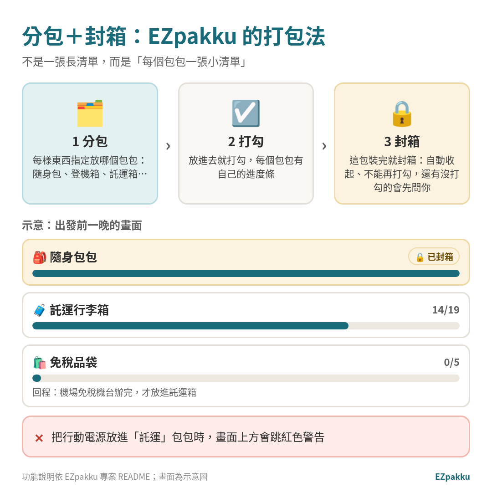
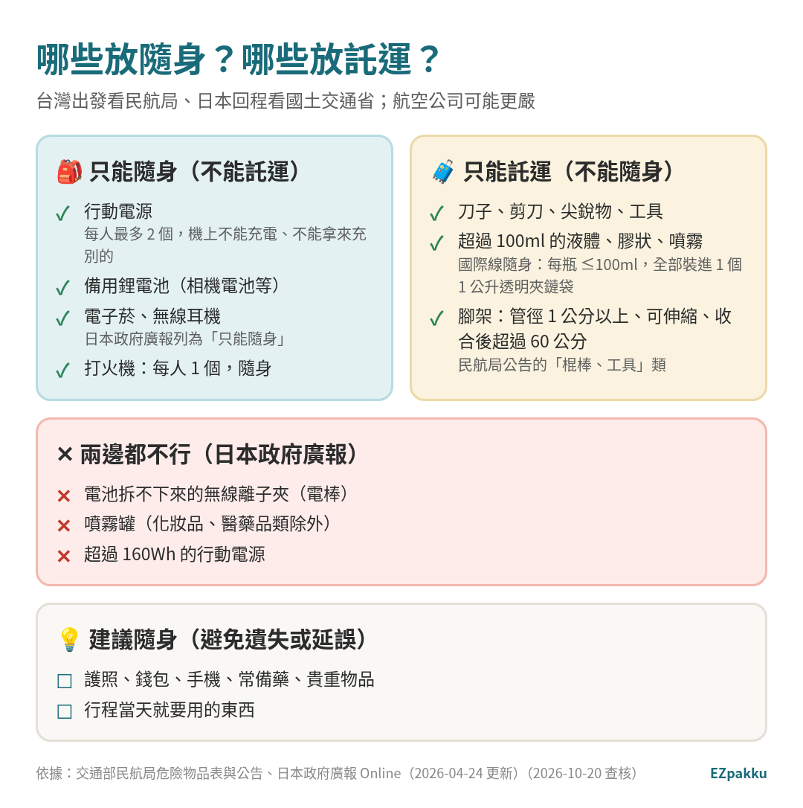
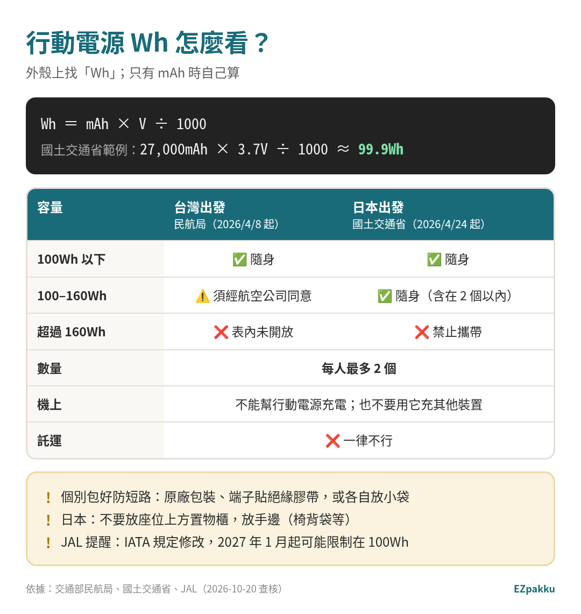
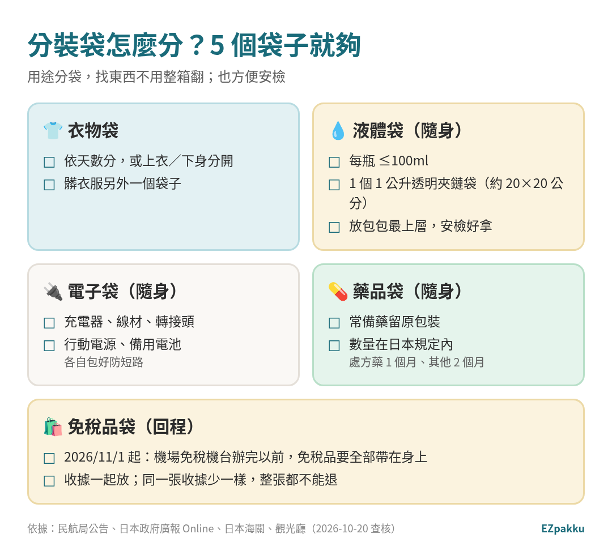

> 📅 資料查核日期：2026-10-20｜規定引用交通部民航局、日本國土交通省、日本政府廣報 Online、JAL、日本觀光廳官方資料

打包最常發生兩件事：**東西明明有帶，卻不知道塞在哪個包**；還有**到機場才發現行動電源放在託運行李裡**。這篇教你用「分包＋封箱」的方法打包，再把 2026 年新的行動電源規定一次講清楚。

---

## 什麼是「分包＋封箱」？

*圖片來源：EZpakku 自製示意圖（功能依 EZpakku 專案說明）*

一般的行李清單是一張長長的表。EZpakku 的做法是**每個包包一張小清單**：

1. **分包：** 每樣東西先指定要放哪個包包，例如「隨身包包」「登機箱」「託運行李箱」。包包可以自己新增、改名、換圖示。
2. **打勾：** 放進去就打勾。畫面上方有總進度，**每個包包也有自己的進度條**。
3. **封箱：** 這一包裝完就按「封箱」。封箱後包包會自動收起、不能再打勾，避免你又翻出來亂放；**還有東西沒打勾就封箱時，會先問你一次**。

另外，**不能託運的東西（例如行動電源）被放進「託運」包包時，畫面上方會跳出紅色警告**。

<strong>📷 圖片待補：EZpakku 新版 App 截圖（封箱畫面＋行動電源放託運的紅色警告）</strong> <small>改名 EZpakku 上線後重拍（舊截圖頂部還是「打包清單」）</small>

> 🧳 **想試試看？** 打開 [**EZpakku**](/zh-tw/)，選目的地和天數產生清單，再把每樣東西分到包包裡，裝完就封箱。

---

## 隨身和託運怎麼分？

*圖片來源：EZpakku 自製（依交通部民航局危險物品表與公告、日本政府廣報 Online 整理）*

去程從台灣出發，看**交通部民航局**的規定；回程從日本出發，看**日本國土交通省**的規定。航空公司可能有更嚴的規定，以航空公司為準。[^mlit-pb]

### 🎒 只能隨身（不能託運）

- **行動電源：** 只能放手提行李，每人最多 2 個。[^caa-pb][^caa-dg]
- **備用鋰電池**（例如相機的備用電池）：只能放手提行李，每顆要個別保護防短路。[^caa-dg]
- **電子菸、無線耳機：** 日本政府廣報列為「可以帶上機、不能託運」。[^govonline]
- **打火機：** 日本出發每人 1 個，隨身攜帶、不能託運。[^govonline]

### 🧳 只能託運（不能隨身）

- **刀類、剪刀、尖銳物品、工具**等。[^caa-gazette][^govonline]
  - 塑膠安全（圓頭）剪刀和圓頭奶油刀不在限制內。[^caa-gazette]
- **超過 100ml 的液體、膠狀、噴霧類：** 國際線隨身的每瓶不能超過 100 毫升，全部裝進 1 個不超過 1 公升（約 20×20 公分）、可重複密封的透明夾鏈袋，**每人 1 袋**；不符合的要放託運。[^caa-gazette][^govonline]
  - 嬰兒牛奶（食品）、藥品、醫療用的液體，在安檢時申報、經同意後可以帶上機。[^caa-gazette]
- **腳架：** 管徑 1 公分以上、可伸縮，而且收合後超過 60 公分的相機腳架，民航局列為不能帶上機。[^caa-gazette]

### ✕ 兩邊都不行（日本出發）

- **電池拆不下來的無線離子夾（電棒）**：隨身、託運都禁止。[^govonline]
- **噴霧罐**（化妝品、醫藥品類除外）。[^govonline]
- **超過 160Wh 的行動電源。**[^govonline][^mlit-pb]

### 💡 建議隨身

護照、錢包、手機、常備藥、貴重物品，以及當天就要用的東西。託運行李萬一延誤，這些也不會跟著不見。

---

## 🔋 行動電源 2026 新規：每人 2 個、機上不能充電

*圖片來源：EZpakku 自製（依交通部民航局、國土交通省、JAL 資料整理）*

國際民航組織（ICAO）修改了行動電源的規範，台灣和日本都跟著改：

| | 台灣出發（民航局） | 日本出發（國土交通省） |
|---|---|---|
| 開始日期 | **2026/4/8** [^caa-pb] | **2026/4/24** [^mlit-pb] |
| 託運 | ❌ 不行，只能手提 [^caa-pb] | ❌ 禁止 [^mlit-pb] |
| 數量 | **每人最多 2 個** [^caa-pb] | **2 個**（限 160Wh 以下）[^mlit-pb] |
| 機上 | 不能幫行動電源充電；建議也不要用它充其他裝置 [^caa-dg] | 不能幫行動電源充電，**也不能用它充其他裝置** [^mlit-pb] |
| 100Wh 以下 | 可以 [^caa-dg] | 可以 [^mlit-pb] |
| 100–160Wh | **須經航空公司同意** [^caa-dg] | 可以（算在 2 個以內）[^mlit-pb] |
| 超過 160Wh | 危險物品表沒有開放 [^caa-dg] | **禁止帶上機** [^mlit-pb] |

**Wh 怎麼算？** 先看外殼上有沒有寫「Wh」。只寫 mAh 的話：[^mlit-pb]

> **Wh ＝ mAh × V ÷ 1000**
> 例：27,000mAh × 3.7V ÷ 1000 ≈ **99.9Wh**（國土交通省範例）

**還要注意：**

- **個別包好防短路：** 放原廠包裝、端子貼絕緣膠帶，或各自放進小袋子。[^caa-dg][^mlit-pb]
- **日本出發：不要放在座位上方的置物櫃**，放在手邊（例如椅背袋）。[^mlit-pb]
- **違反規定可能受罰：** 國土交通省說明，違反託運、容量（160Wh）、防短路、數量、機上幫行動電源充電等規定，可能依航空法處罰。[^mlit-pb]
- **之後可能更嚴：** JAL 提醒，IATA 規定修改後，**2027 年 1 月以後可能限制在 100Wh**。[^jal-pb]

> EZpakku 的「行動電源」項目有「僅限隨身」標籤，點開可以看到說明和官方來源連結。

---

## 🗂️ 分裝袋怎麼分？5 個袋子就夠

*圖片來源：EZpakku 自製（依民航局公告、日本政府廣報 Online、日本海關、觀光廳資料整理）*

分裝袋（packing cubes）不用買很多，照「用途」分就好。在 EZpakku 裡，每個分裝袋都可以當成一個「包包」來管理：

1. **衣物袋（託運箱）：** 依天數分，或上衣、下身分開；髒衣服另一袋。
2. **液體袋（隨身）：** 每瓶 100ml 以下，1 個 1 公升透明夾鏈袋，放包包最上層，安檢時好拿。[^caa-gazette]
3. **電子袋（隨身）：** 充電器、線材、轉接頭、行動電源、備用電池。電池各自包好防短路。[^caa-dg]
4. **藥品袋（隨身）：** 常備藥留原包裝。帶進日本有數量上限：處方藥 1 個月份、其他藥品 2 個月份以內。[^customs-9005]
5. **免稅品袋（回程）：** 2026/11/1 起購買的免稅品，要在**託運行李之前**全部帶到機場免稅機台；同一張收據少一樣，整張都不能退。[^kankocho] 辦完再放進託運箱。詳細看 👉 [日本免稅怎麼買、怎麼退](/zh-tw/blog/japan-tax-free-refund/)

---

## ✅ 實用技巧

- **出發前一晚就封箱。** 早上只剩隨身包要確認，比較不會慌。
- **行動電源、相機電池、無線耳機一律放「隨身」包。** 在 EZpakku 放錯包包會跳警告。
- **液體袋放在最好拿的位置。** 安檢時要拿出來。
- **回程預留一個空的分裝袋給免稅品。** 機場辦完退稅再放進託運箱。
- **想知道去日本要帶哪些東西？** 看 👉 [日本行李清單：去日本要帶什麼](/zh-tw/blog/japan-packing-list/)

## ⚠️ 常見錯誤

1. **行動電源放託運行李。** 台灣、日本都禁止。[^caa-pb][^mlit-pb]
2. **帶 3 個以上行動電源。** 每人最多 2 個。[^caa-pb][^mlit-pb]
3. **在機上用行動電源幫手機充電。** 日本出發的航班禁止；[^mlit-pb] 台灣民航局也建議不要。[^caa-dg]
4. **大罐保養品放隨身。** 超過 100ml 要託運。[^caa-gazette]
5. **帶電池拆不下來的無線離子夾。** 日本出發隨身、託運都不行。[^govonline]
6. **免稅品先放進託運箱。** 新制下要先去機台再託運。[^kankocho]

---

## 常見問題 FAQ

**Q1：我的行動電源沒寫 Wh 怎麼辦？**
用外殼上的 mAh 和 V 自己算：Wh＝mAh×V÷1000。[^mlit-pb] 標示都看不清楚的話，建議不要帶。

**Q2：筆電、相機可以託運嗎？**
民航局表格寫，含鋰電池的可攜式電子裝置**建議放手提行李**；如果託運，必須**完全關機**（不是睡眠或休眠）並防止意外啟動。[^caa-dg] 備用電池則只能隨身。[^caa-dg]

**Q3：去程和回程規定一樣嗎？**
大方向一樣（每人 2 個、不能託運、機上不能充電），細節不同：例如 100–160Wh 的行動電源，台灣民航局寫「須經航空公司同意」，日本國土交通省則是限 160Wh 以下、2 個以內。[^caa-dg][^mlit-pb] 航空公司可能更嚴。

**Q4：EZpakku 一定要分很多包嗎？**
不用。預設就有「隨身包包」，加上「登機箱」或「託運行李箱」。要用分裝袋管理的人，再自己新增包包就好。

**Q5：封箱之後發現漏東西怎麼辦？**
按「解除封箱」就能再打開。

---

> 🧳 **現在就試：** 打開 [**EZpakku**](/zh-tw/)，把東西分到隨身包、託運箱和分裝袋裡，一包一包裝、一包一包封箱。

---

## 📚 延伸閱讀

- [手機 10 分鐘搞定 Visit Japan Web（入境、海關 QR 碼）](/zh-tw/blog/visit-japan-web/)
- [日本行李清單：去日本要帶什麼](/zh-tw/blog/japan-packing-list/)
- [日本免稅怎麼買、怎麼退（2026/11/1 新制）](/zh-tw/blog/japan-tax-free-refund/)
- [日本 eSIM 和網卡怎麼選](/zh-tw/blog/japan-esim-wifi/)

---

## 資料來源（查核日期：2026-10-20）

[^caa-pb]: 交通部民用航空局〈4月8日起，旅客搭機限帶2個行動電源〉（2026/4/2） https://www.caa.gov.tw/NewsPublish-Content.aspx?a=381&lang=1&nid=2547
[^caa-dg]: 交通部民用航空局〈旅客及組員可攜帶或託運上機之危險物品表〉 https://www.caa.gov.tw/FileAtt.ashx?id=40793&lang=1
[^caa-gazette]: 行政院公報〈交通部民用航空局公告：其他有影響飛航安全之虞不得攜帶進入航空器之物品名稱〉（106/3/22） https://gazette.nat.gov.tw/EG_FileManager/eguploadpub/eg023052/ch06/type1/gov50/num18/Eg.htm
[^mlit-pb]: 日本國土交通省〈モバイルバッテリーの機内持込みの新たなルールについて〉（2026/4/14，含別紙 1【旅客の皆様へ】） https://www.mlit.go.jp/report/press/kouku10_hh_000310.html ／PDF：https://www.mlit.go.jp/report/press/content/001995959.pdf
[^govonline]: 日本政府廣報 Online〈空港での保安検査をスムーズに通過するために〉（2026/4/24） https://www.gov-online.go.jp/article/202403/entry-5822.html
[^jal-pb]: JAL〈モバイルバッテリーの機内持ち込み個数および充電に関するルール変更についてのお願い（2026年4月24日以降）〉 https://www.jal.co.jp/jp/ja/info/2026/other/260330/
[^customs-9005]: 日本海關〈9005 海外旅行者向け（医薬品・化粧品等）〉 https://www.customs.go.jp/tetsuzuki/c-answer/sonota/9005_jr.htm
[^kankocho]: 日本觀光廳〈旅行者向け特設ページ（リファンド方式）〉 https://www.mlit.go.jp/kankocho/tax-free/page01_000001_00021.html

> 本文只整理官方公開資料，航空規定隨時可能變更，搭機前請以民航局、國土交通省和你搭乘的航空公司最新公告為準。EZpakku 功能以實際上線版本為準。
