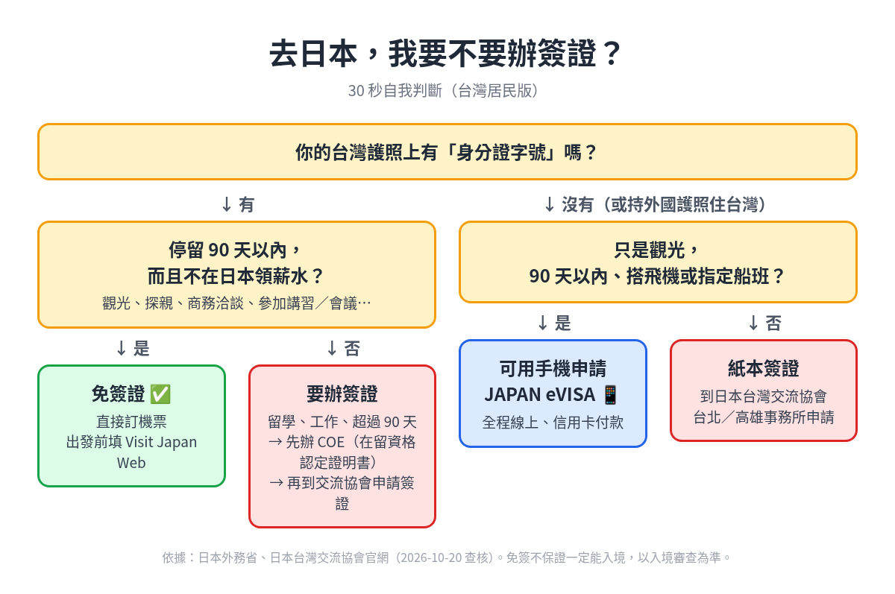
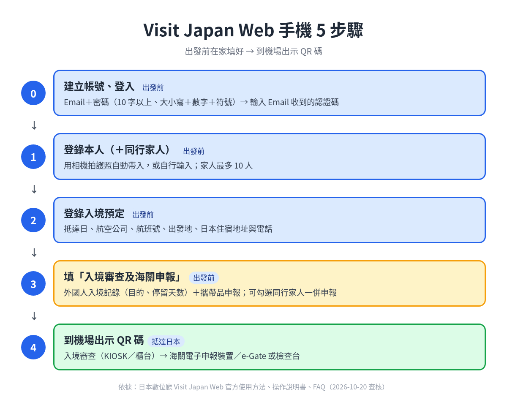

> 📅 資料查核日期：2026-10-20｜內容只引用日本數位廳、外務省、日本台灣交流協會、出入國在留管理廳的官方資料

下飛機後排長長的入境隊伍，手上還在填紙本卡？其實可以出發前就在家用手機填好 **Visit Japan Web（VJW）**，到機場只要出示一個 QR 碼，就能辦入境審查和海關申報。[^vjw-svc] 這篇用圖一步一步帶你做完。

---

## 先確認：台灣人去日本要不要簽證？

*圖片來源：EZpakku 自製（依日本台灣交流協會、外務省、出入國在留管理廳資料整理）*

三句話講完：

1. **台灣護照上有身分證字號，去觀光、商務、探親，90 天內不用簽證。**[^koryu-resident][^mofa-novisa]
2. **不能在日本工作賺錢。** 要工作、留學或停留超過 90 天，就要先辦簽證；留學的話要先申請 COE（在留資格認定證明書）。[^koryu-exemption][^isa-qa]
3. **Visit Japan Web 不是簽證**，而是入境手續的電子工具。要不要簽證，官方 FAQ 請你看外務省網站。[^vjw-faq]

> 「eVISA 是什麼？」「留學怎麼辦？」放在文末 FAQ。

---

## Visit Japan Web 是什麼？

| 重點 | 官方說法 |
|---|---|
| 誰提供 | 日本**數位廳**（Digital Agency）[^vjw-svc] |
| 做什麼 | 預先登錄入境手續（入境審查、海關申報）需要的資料，入境時出示 QR 碼。外國旅客在日本也可以用它辦免稅購物。[^vjw-svc] |
| 要錢嗎 | **免費。** 數位廳提醒，有網站假借代辦 QR 碼收手續費，使用 VJW 不需要付任何費用。[^vjw-news-fee] |
| 有 App 嗎 | **沒有**，只能用瀏覽器。數位廳說它們不提供應用程式，若下載到「Visit Japan Web info」這類可疑 App，請立刻刪除。[^vjw-news-app] |
| 一定要用嗎 | ⚠️ **官方資料查不到「強制使用」的說法。** 它被定位成讓入境更順的服務，FAQ 也附了海關紙本申報書的說明連結。[^vjw-svc][^vjw-faq] |

> 💡 **小提醒**
> 用電腦也可以登錄資料，**但入境時一定要用手機或平板出示 QR 碼。**[^vjw-svc] 官方推薦的瀏覽器是 iPhone 用 Safari 或 Chrome、Android 用 Chrome，都用最新版。[^vjw-faq]

*圖片來源：EZpakku 自製（依日本數位廳 VJW 使用方法、操作說明書、FAQ 整理）*

---

## 出發前要準備什麼？

- 📧 **一個能收信的 Email。** 建立帳號一定要有效的 Email。[^vjw-faq]
- 🛂 **護照。** 可以用手機相機拍下自動帶入。護照效期不到 6 個月時，系統會跳出警告。[^vjw-guide]
- ✈️ **機票資訊。** 抵達日、航空公司、航班號碼、出發地。[^vjw-manual-4]
- 🏨 **日本的住宿資料。** 地址（郵遞區號可以自動帶入）、飯店名稱、在日本聯絡得到的電話。[^vjw-manual-4]
- 📱 **手機。** 到了日本要能出示 QR 碼。先登入過的話，沒網路也能顯示（見下方技巧）。[^vjw-faq]

---

## 📱 手機操作 Step by Step

### STEP 0｜建立帳號

1. 用手機瀏覽器打開 Visit Japan Web，右上角語言選「中文（繁體）」，點 **「建立新帳號」**。[^vjw-manual-2]

   
<strong>📷 圖片待補：iPhone VJW 截圖 #1 首頁（登入／語言選擇畫面）</strong> <small>RY 用 iPhone 實機截圖；個資、護照號碼和 QR 碼請先打馬賽克</small>

2. 勾選同意「使用規約」和「個人隱私權條款」，按「下一步」。[^vjw-manual-2]

   
<strong>📷 圖片待補：iPhone VJW 截圖 #2 建立新帳號（同意規約畫面）</strong> <small>RY 用 iPhone 實機截圖；個資、護照號碼和 QR 碼請先打馬賽克</small>

3. 輸入 Email 和密碼，完成「我是真實訪客」驗證。[^vjw-manual-2]
   - Email 限 128 字元以內。
   - 密碼要 **10 個字元以上**，而且要有**大寫＋小寫英文＋數字＋符號**。
4. 打開信箱，把收到的**認證碼**輸入後按「建立新帳號」。[^vjw-manual-2]
   - ⚠️ 帳號建立完成前**不要關掉這個畫面**，不小心關掉的話認證碼會失效，要從頭再取一次。
   - 收不到信時，先看垃圾郵件匣，並確認沒有擋掉 `@vjw.digital.go.jp`。

5. 回到登入畫面，用 Email 和密碼登入。[^vjw-manual-2]
   - 第一次登入會問要不要開「多因素驗證」。這是**選擇性**的，不開也能正常用。
   - 如果開了，之後每次登入都要輸入驗證 App（例如 Google Authenticator）上的碼，所以**換手機前要先處理好**。[^vjw-faq]

### STEP 1｜登錄本人資料（＋同行家人）

1. 在首頁點 **「本人資料」**。[^vjw-manual-3]
2. 回答分類問題：[^vjw-manual-3]
   - 「持有日本政府發行的護照嗎？」→ 台灣人選 **否**。
   - 「持有再入國許可嗎？」→ 一般旅客選 **否**。
   - 「要用免稅 QR 碼嗎？」→ 依需要選。
3. 選 **「使用相機讀取」**（官方預設也建議用這個），把護照對準白色框，點「拍攝護照」。
   - 反光可能讀取失敗，重拍或改「自行輸入」都可以。[^vjw-manual-3]
   - 讀完後**一定要核對**自動帶入的護照號碼、姓名、國籍、生日和效期。[^vjw-manual-3]

   
<strong>📷 圖片待補：iPhone VJW 截圖 #3 護照拍照畫面、#4 護照資料確認畫面</strong> <small>RY 用 iPhone 實機截圖；個資、護照號碼和 QR 碼請先打馬賽克</small>

4. 輸入職業和現住地（國家、城市），確認後按「登錄」。[^vjw-manual-3]
5. **同行家人：** 首頁點「同行家人資料」→「追加」，步驟和本人一樣。[^vjw-manual-3]
   - **最多 10 人。**
   - 必須是同時辦入境的家人，而且手續是一人一份，每個人的資料都要分別登錄。

### STEP 2｜登錄入境預定

1. 首頁點 **「新增登錄入境、回國預定」**，選「不沿用並繼續登錄」。[^vjw-manual-4]
   - 如果你有日本簽證，可以輸入「VISA 發行編號」帶入資料。
2. 填入以下資料：[^vjw-manual-4]
   - 抵達日本的日期（最遠可以登錄到**隔年 12/31**）。
   - 航空公司和航班號。聯營航班請填**主要的航空公司和航班號**。
   - 出發地。
3. 填日本的住宿地址、飯店名稱、電話。[^vjw-manual-4]
4. 有同行家人的話，勾選他們，確認內容後登錄。[^vjw-manual-4]

<strong>📷 圖片待補：iPhone VJW 截圖 #5 同行家人、#6 登錄入境預定</strong> <small>RY 用 iPhone 實機截圖；個資、護照號碼和 QR 碼請先打馬賽克</small>

### STEP 3｜填「入境審查及海關申報」

點剛剛登錄的行程，進入「日本入境、回國手續」畫面。[^vjw-manual-7]

1. **檢疫（確認健康狀況）：** 回答健康問題，系統會顯示厚生勞動省的相關資訊。你的回答**不會被儲存**。[^vjw-faq]
2. **入境審查（外國人入境記錄）：** 點「入境審查及海關申報」，依序填基本資料、住宿處、入境目的、**預定停留天數**，再回答提問事項。[^vjw-manual-7]
   - 官方畫面特別提醒「預定停留日數常有輸入錯誤」，觀光、商務、探親的旅客要填 **90 天以下**。[^vjw-manual-7]

   
<strong>📷 圖片待補：iPhone VJW 截圖 #7 入境審查（外國人入境記錄）</strong> <small>RY 用 iPhone 實機截圖；個資、護照號碼和 QR 碼請先打馬賽克</small>

3. **海關申報（攜帶品、後送物品申報）：** 依序回答 5 頁提問，例如有沒有帶禁止進口的物品，再填菸、酒、香水等數量。[^vjw-manual-7]
   - 自用的購買品，同一品項海外市價合計 **1 萬日圓以下不用填**；後送物品也不用填在這裡。[^vjw-manual-7]
   - **代表人可以選「同行家人一併申報」**，家人就能省略部分欄位。不過用電子申報裝置時，**每個人還是要有自己的 QR 碼**。[^vjw-faq][^vjw-manual-7]

   
<strong>📷 圖片待補：iPhone VJW 截圖 #8 海關申報</strong> <small>RY 用 iPhone 實機截圖；個資、護照號碼和 QR 碼請先打馬賽克</small>

4. 最後勾選「以上的輸入內容均與事實相符」，按「登錄」，看到「已成功完成登錄」就完成了。[^vjw-manual-7]

### STEP 4｜到機場出示 QR 碼

1. 在「日本入境、回國手續」畫面點 **「顯示QR碼」**，看完注意事項後按 **「同意並出示QR碼」**。[^vjw-manual-7]
   - ⚠️ 出示 QR 碼就代表你同意「申報內容與事實相符」。官方警告，申報不實可能被取消在留資格。[^vjw-manual-7]
2. 確認畫面上的姓名是本人。有家人的話，用下拉選單**切換對象者**，就能顯示家人的 QR 碼。[^vjw-manual-7]
3. 從 2024/1/25 起，**入境審查和海關申報共用同一個 QR 碼**，之前產生的舊 QR 碼不能再用。[^vjw-news-qr]

<strong>📷 圖片待補：iPhone VJW 截圖 #9「同意並出示QR碼」、#10 QR 碼畫面</strong> <small>RY 用 iPhone 實機截圖；個資、護照號碼和 QR 碼請先打馬賽克</small>

**到機場怎麼走（數位廳官方影片流程）：**[^vjw-video]

1. 下飛機後跟著指標走到 **KIOSK** 機台。
2. 打開 VJW，顯示 QR 碼。
3. 在 KIOSK 掃 QR 碼、護照和指紋，再拍臉部照片。
4. 跟著指標到入境審查櫃台，完成入境審查。
5. 到海關區，跟著指標走 **電子申報閘門（e-Gates）**，通過就完成入境。

這個 QR 碼可以在入境審查櫃台、海關的電子申報裝置或檢查台使用。在電子申報裝置申報後，就能走電子申報閘門。[^vjw-guide]

---

## ✅ 實用技巧

- **出發前在家填好。** 大部分功能需要網路，要先上網登入過，到了日本沒網路也能用。[^vjw-faq]
- **QR 碼離線也能叫出來。** 只要事先上網登入、**保持登入狀態**，沒網路也能產生入境審查及海關申報的 QR 碼。但「編輯同行家人」要連網，機場免費 Wi-Fi 也能用。[^vjw-faq][^vjw-manual-offline]
- **加到主畫面。** 官方說明書教你把 VJW 加到手機主畫面，安裝離線服務：[^vjw-manual-offline]
  - iPhone（Safari）：點登入畫面上說明書標示的圖示 →「加入主畫面」→「新增」。
  - Android：Chrome 彈出視窗 →「將 Visit Japan Web 新增至主畫面」，或右上角「︙」→「加到主畫面」。
- **入境用的 QR 碼可以截圖。** 官方畫面寫「QR碼也可以透過截圖的方式使用」，**但資料修改後要重新產生 QR 碼**，舊截圖就不能用了。[^vjw-manual-7]
  - ⚠️ 免稅用的 QR 碼則是**不能截圖**，兩者不要搞混。[^vjw-guide]
- **一個 Email 只能開一個帳號。** 原則上一人一帳號，但全家一起入境時，可以把家人登錄在代表人的帳號裡，一起產生 QR 碼。[^vjw-faq]
- **帳號會自動刪除。** 最後一次登入後滿 **1 年半**，帳號和資料就會被刪除。[^vjw-faq]
- **卡住了怎麼辦？** 點畫面上方的「？」看 FAQ，或用官方聊天機器人詢問。[^vjw-manual-1][^vjw-svc]

## ⚠️ 常見錯誤

1. **下載到假 App，或付錢給代辦網站。** VJW 沒有 App，也是免費的。[^vjw-news-app][^vjw-news-fee]
2. **停留天數填錯。** 免簽觀光要填 90 天以下。[^vjw-manual-7]
3. **建立帳號時關掉認證碼畫面**，認證碼就失效了。[^vjw-manual-2]
4. **改了資料還在用舊截圖。** 修改後要重新產生 QR 碼。[^vjw-manual-7]
5. **拿 2024/1/25 以前的舊 QR 碼。** 現在要用統一後的新 QR 碼。[^vjw-news-qr]
6. **開了多因素驗證後換手機**，結果登不進去。官方的解法是刪除帳號重建，所以換機前要先處理好。[^vjw-faq]
7. **以為家人不用填。** 同行家人也要辦一樣的手續，資料要每個人分別登錄。[^vjw-faq][^vjw-manual-3]

---

## 常見問題 FAQ

**Q1：用 Visit Japan Web 就等於有簽證嗎？**
不是。VJW 只處理入境審查和海關申報的資料。要不要簽證，官方 FAQ 請你看外務省網站。[^vjw-faq]

**Q2：一定要用 VJW 嗎？**
我在官方資料中**沒有查到強制使用的說明**。官方 FAQ 也附了海關紙本申報書的說明頁。[^vjw-faq]

**Q3：最晚什麼時候要填好？有沒有「起飛前幾小時」的限制？**
官方資料只寫抵達日可以登錄到隔年 12/31，[^vjw-manual-4] **我沒有查到最晚要多久之前填好的官方規定。** 建議出發前在家連網填完、確認 QR 碼叫得出來。

**Q4：可以幫爸媽或小孩一起填嗎？**
可以。登錄為同行家人（最多 10 人），用同一個帳號產生每個人的 QR 碼，出示時用下拉選單切換。[^vjw-manual-3][^vjw-manual-7][^vjw-faq]

**Q5：JAPAN eVISA 是什麼？台灣人需要嗎？**
eVISA 是外務省的線上觀光簽證，只給**需要簽證**的人用，例如住在台灣、但護照上沒有身分證字號的人。持一般台灣護照、有身分證字號的人本來就免簽，**不用申請**。[^mofa-evisa]
- 要在機場連網登入，顯示「Visa issuance notice」，**不接受截圖或列印本**。[^mofa-evisa]
- 拿到 eVISA 的人，在 VJW 的「入境預定」裡可以輸入 VISA 發行編號帶入資料。[^vjw-manual-4]

**Q6：我要去日本留學 1～3 個月，可以免簽嗎？**
- 免簽最多 90 天，原則上不能延長。[^koryu-resident][^isa-tv]
- 短期停留的活動包括「參加講習」，[^isa-tv][^koryu-detail1] **但官方沒有明講「上語言學校的短期課程」算不算**，要先問學校和交流協會。
- 要辦「留學」的話，學校通常會代你申請 COE，COE 也可以用 Email 寄給你。[^isa-jls][^isa-ecoe] 簽證本身要**本人到日本台灣交流協會**申請，簽證會貼在護照上。[^koryu-coe]

---

> 🧳 **行李還沒打包？** 用 [**EZpakku**](/zh-tw/) 產生你的日本行李清單，出發前一次檢查完。

---

## 資料來源（查核日期：2026-10-20）

[^vjw-svc]: 日本數位廳〈Visit Japan Web〉服務頁 https://services.digital.go.jp/zh-cmn-hant/visit-japan-web/
[^vjw-guide]: 日本數位廳〈Visit Japan Web 使用方法〉 https://services.digital.go.jp/zh-cmn-hant/visit-japan-web/guide/
[^vjw-faq]: Visit Japan Web〈常見問題（FAQ）〉 https://www.vjw.digital.go.jp/main/#/vjwpco011-zh-cmn-Hant
[^vjw-manual-1]: 《Visit Japan Web 操作說明書》（繁體中文）第 1 章 1-2 FAQ、詢問 https://www.vjw.digital.go.jp/manual/main/visitjapanweb_manual_zh-cmn-Hant.html
[^vjw-manual-2]: 同上，第 2 章 建立新帳號・登入（2-1、2-2）
[^vjw-manual-3]: 同上，第 3 章 登錄使用者（3-1 本人資料登錄、3-3 同行家人資料登錄）
[^vjw-manual-4]: 同上，第 4 章 登錄入境、回國預定（4-1）
[^vjw-manual-7]: 同上，第 7 章 入境審查及海關申報登錄（外國人士）（7-1～7-3，含畫面截圖內文字）
[^vjw-manual-offline]: 同上，附頁「離線狀態使用」（事前準備、注意與限制事項）
[^vjw-news-fee]: 日本數位廳〈關於使用Visit Japan Web的通知〉（2025/6/5） https://services.digital.go.jp/zh-cmn-hant/visit-japan-web/news/20250605-01/
[^vjw-news-app]: 日本數位廳〈我們發現叫做Visit Japan Web info等可疑應用〉（2023/12/14） https://services.digital.go.jp/zh-cmn-hant/visit-japan-web/news/20231214-01/
[^vjw-news-qr]: 日本數位廳〈統一了入境審查和海關申報的二維碼〉（2024/1/25） https://services.digital.go.jp/zh-cmn-hant/visit-japan-web/news/20240125-01/
[^vjw-video]: 日本數位廳新聞〈Streamline your CIQ experience with Visit Japan Web〉影片文字稿（2025/10/23） https://digital-agency-news.digital.go.jp/articles/2025-10-23-2_subtitles
[^mofa-novisa]: 日本外務省〈Exemption of Visa (Short-Term Stay)〉 https://www.mofa.go.jp/j_info/visit/visa/short/novisa.html
[^mofa-evisa]: 日本外務省〈The JAPAN eVISA system (electronic visa)〉 https://www.mofa.go.jp/j_info/visit/visa/visaonline.html
[^koryu-resident]: 日本台灣交流協會〈關於對台灣居民繼續實施免簽證措施〉 https://www.koryu.or.jp/tw/visa/taipei/resident/
[^koryu-exemption]: 日本台灣交流協會〈致以免簽證方式入境日本之各位〉 https://www.koryu.or.jp/tw/visa/taipei/exemption/
[^koryu-detail1]: 日本台灣交流協會〈短期停留期間可進行之活動內容（具體實例）〉 https://www.koryu.or.jp/tw/visa/taipei/exemption/detail1/
[^koryu-coe]: 日本台灣交流協會〈台灣護照持有「在留資格認定證明書」者〉 https://www.koryu.or.jp/tw/visa/taipei/general/detail1/
[^isa-tv]: 出入國在留管理廳〈在留資格「短期滞在」〉 https://www.moj.go.jp/isa/applications/status/temporaryvisitor.html
[^isa-qa]: 出入國在留管理廳〈出入国審査・在留審査Q&A〉 https://www.moj.go.jp/isa/immigration/faq/kanri_qa.html
[^isa-jls]: 出入國在留管理廳〈日本語教育機関への入学をお考えのみなさまへ〉 https://www.moj.go.jp/isa/applications/resources/nyuukokukanri07_00159.html
[^isa-ecoe]: 出入國在留管理廳〈在留資格認定証明書の電子化について〉 https://www.moj.go.jp/isa/applications/procedures/10_00136

> 本文只整理官方公開資料，規定隨時可能變更，出發前請以官網最新公告為準。文中的流程圖為 EZpakku 自製；實機操作截圖待補。
